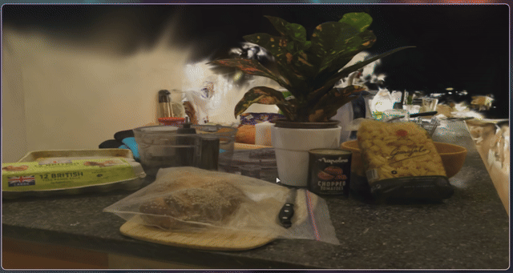

# SplatScope

A 3D Gaussian Splatting viewer written in C++ and CUDA.

  

SplatScope renders scenes trained with [3D Gaussian Splatting](https://repo-sam.inria.fr/fungraph/3d-gaussian-splatting/)
(Kerbl et al., SIGGRAPH 2023).
It is a learning project contains:  Projection -> Prefix sum -> Duplicate -> Radix sort -> Tile ranges -> Blend

