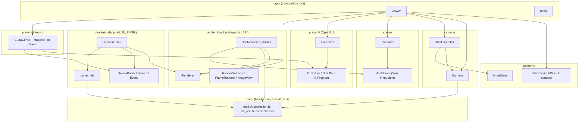
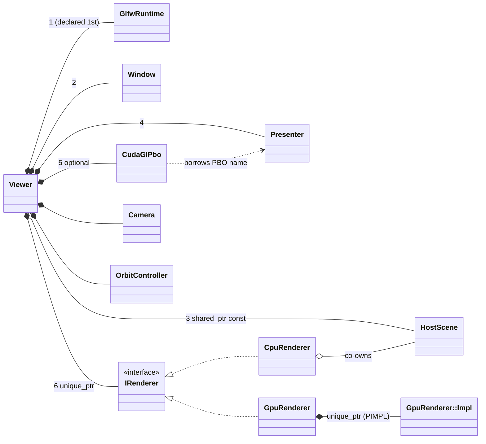
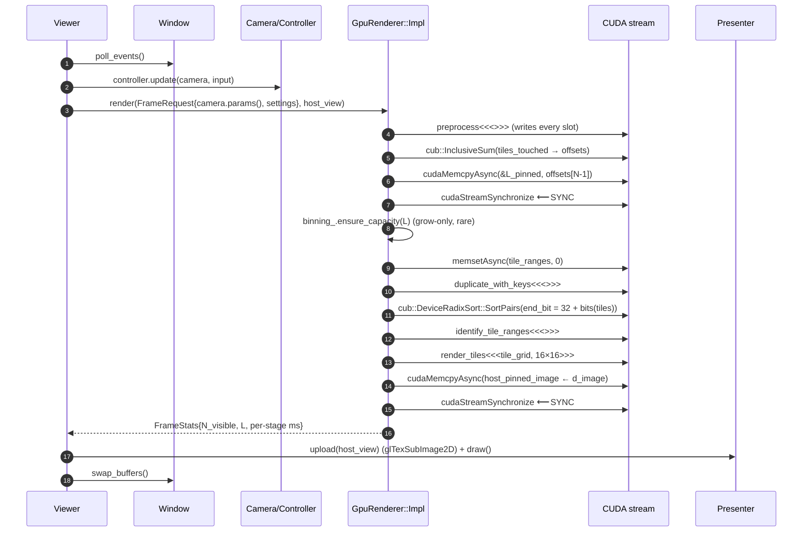

# 02 — Architecture

> **Mental model:** data flows one way, *disk → host scene (immutable) → device scene (immutable) → per-frame transient buffers → image → screen*. Every buffer belongs to exactly one *lifetime class*, and every lifetime class has exactly one *owner*. If you can say who owns a buffer and when its size changes, you know its allocation policy, its destructor, and its sync requirements.

---

## 1. Layers and dependency direction

The rule: **dependencies point downward only.** Core math knows nothing about CUDA, GL or Eigen. The CUDA backend knows nothing about GL, except through one narrow interop adapter. The app layer is the only place where everything meets.



**Why this split pays off:**

- `core/` compiles both as plain C++ (into the CPU oracle and unit tests) and as CUDA (into kernels). **One formula, two compilers.** CPU-vs-GPU tests then exercise your *plumbing* (indices, layouts, sync), not two hand-written copies of the maths that may disagree. That disagreement is exactly what happened in A5/E1–E4 of the review.
- `render/cuda/` is a static library behind a PIMPL facade. No `cuda_runtime.h` leaks into `viewer.cpp`. With `SPLATSCOPE_WITH_CUDA=OFF` the project still builds and runs on the CPU oracle.
- `present/` owns all OpenGL state. Today *each* renderer owns its own `Display`, so switching renderers at runtime would build two shader programs and two textures. Moving presentation out means a **runtime CPU⇄GPU toggle** costs nothing, which makes visual A/B comparison a single keypress.

### Proposed directory layout

```
src/
  app/            main.cpp, viewer.{h,cpp}
  platform/       window.{h,cpp}, glfw_runtime.{h,cpp}, input_state.h
  camera/         camera.{h,cpp}, orbit_controller.{h,cpp}, camera_params.h (POD for kernels)
  scene/          host_scene.h, ply_loader.{h,cpp}, scene_stats.{h,cpp} (AABB, counts)
  core/           hd.h (SPLAT_HD macro), math.h, projection.h, tile_rect.h, compositing.h, conventions.h
  render/         renderer.h (IRenderer), render_settings.h, image_view.h, frame_stats.h
  render/cpu/     cpu_renderer.{h,cpp}
  render/cuda/    gpu_renderer.h (PIMPL facade, no CUDA types)
                  gpu_renderer.cu (Impl), cuda_check.h, device_buffer.h, stream.h, event.h
                  kernels/preprocess.cu, binning.cu, render.cu, debug_views.cu, kernel_args.h
  present/        presenter.{h,cpp}, gl_resources.h, shaders/
  present/interop cuda_gl_pbo.{h,cpp}
tests/            core/, cpu/, cuda/, golden/
```

---

## 2. Class responsibilities

| Class | Responsibility (one sentence) | Owns | Borrows | Lifetime |
|---|---|---|---|---|
| `GlfwRuntime` | `glfwInit`/`glfwTerminate` as RAII | process-wide GLFW state | — | whole app |
| `Window` | GLFW window + GL context + raw input → `InputState` | `GLFWwindow*` | `GlfwRuntime` (must outlive) | whole app; **non-copyable, non-movable** |
| `HostScene` | Immutable, decoded, validated Gaussians in GPU-ready SoA | `std::vector<float4>`… | — | shared via `shared_ptr<const HostScene>` |
| `PlyLoader` | Bytes → `HostScene` (activation, validation, layout) | nothing after return | — | stateless function |
| `Camera` | Pose (orbit params) + intrinsics → `CameraParams` POD | its params | — | value type |
| `OrbitController` | `InputState` deltas → camera changes | sensitivities | `Camera&` per call | value type |
| `IRenderer` | `FrameRequest` + `ImageView` → pixels + `FrameStats` | its backend state | `ImageView` per call | per backend |
| `CpuRenderer` | Reference implementation of the same model | float accum buffer, per-Gaussian arrays | `shared_ptr<const HostScene>` (co-owns) | |
| `GpuRenderer` | CUDA forward pass (facade) | `unique_ptr<Impl>` | `ImageView` per call | |
| `GpuRenderer::Impl` | Stream, all device buffers, timers | everything device-side | — | |
| `Presenter` | Texture + quad + shader; show an image | GL texture, VAO/VBO, program, (PBO) | — | needs live GL context |
| `CudaGlPbo` | Register a GL PBO with CUDA; hand out mapped device pointers | `cudaGraphicsResource_t` | the PBO's GL name (owned by `Presenter`) | **must die before the PBO and before the GL context** |
| `MappedPbo` | RAII *lease*: map in ctor, unmap in dtor | the mapping | `CudaGlPbo&` | one frame (scope) |

**Two ideas to take from the table:**

1. **Owner vs. view.** `DeviceBuffer<T>` *owns* (move-only, frees in its destructor). `DeviceSpan<T>` / `ImageView` is a *view* (trivially copyable pointer + size, never frees). Kernels and per-call APIs take views; long-lived objects hold owners. This is the `std::vector` / `std::span` split applied to device memory, and it makes ownership visible in every function signature.
2. **Leases for temporarily valid resources.** A mapped interop pointer is only valid between `cudaGraphicsMapResources` and `cudaGraphicsUnmapResources`. Encoding that window as an object's lifetime (`MappedPbo`) makes "used after unmap" a compile-visible scope error instead of a runtime fault.

---

## 3. Ownership graph



### Ownership policy decisions (and why)

| Question | Decision | Reasoning / failure mode avoided |
|---|---|---|
| Who owns host Gaussian data? | `Viewer` holds `shared_ptr<const HostScene>` | **Immutable + shared** = no data races and no defensive copies. `const` in the pointee type means no renderer can mutate it |
| Does `GpuRenderer` keep the host scene? | **No.** `upload(const HostScene&)` copies to the device and retains nothing | A raw `const Scene*` (today) dangles if `Viewer` reorders members. "Copy then forget" has no lifetime coupling at all |
| Does `CpuRenderer` keep it? | Yes, a `shared_ptr` copy | It reads host data every frame, so it must co-own it. Shared ownership states that need in the type |
| Who owns GL objects? | Only `Presenter` (and `CudaGlPbo` for the registration) | One owner of the GL context's objects; no renderer touches GL |
| Who owns device memory? | Only `GpuRenderer::Impl`, via `DeviceBuffer<T>` members | One destructor frees everything; no free functions to forget (review C1) |
| Can owners be copied? | **No.** Copy is deleted on every resource owner; move is allowed except for `Window` | Copying a handle without its ownership means a double free (review C3) |

---

## 4. Construction and destruction order

C++ constructs members **in declaration order** and destroys them in **reverse**. The order of declarations in `Viewer` *is* the resource-dependency graph, so write it down and comment it:

```cpp
class Viewer {
    // Order is load-bearing: each member may depend on everything declared above it.
    GlfwRuntime                       glfw_;       // 1. glfwInit
    Window                            window_;     // 2. GL context (current on this thread)
    std::shared_ptr<const HostScene>  scene_;      // 3. CPU data; no GL/CUDA dependency
    Presenter                         presenter_;  // 4. GL objects: needs context
    std::optional<CudaGlPbo>          interop_;    // 5. registers presenter_'s PBO with CUDA
    std::unique_ptr<IRenderer>        renderer_;   // 6. device memory, stream
    Camera                            camera_;
    OrbitController                   controller_;
};
```

Destruction runs bottom-up: renderer (frees device memory, destroys the stream) → interop (unregisters the PBO *while the PBO and context still exist*) → presenter (deletes GL objects *while the context exists*) → scene → window (destroys the context) → glfw (terminates).

**Failure modes this ordering prevents:**

- Deleting GL objects after the context is gone: errors at best, a driver crash at worst.
- Unregistering a CUDA graphics resource after its GL buffer was deleted: undefined behaviour in the driver.
- The CUDA primary context: device memory freed in `Impl`'s destructor is fine as long as it runs before `main` returns. **Never** keep a `DeviceBuffer` in a `static` or global; the CUDA runtime may already be torn down when static destructors run.

**Loading the scene before creating the window** (today's order) is a nice touch worth keeping, because a bad path fails fast without flashing a window. To keep it with the order above, load the scene in `main` and pass `shared_ptr<const HostScene>` into `Viewer`'s constructor.

---

## 5. Per-frame control flow

### Phase A — readback presentation (build this first)



### Phase B — CUDA-GL interop (no image crosses PCIe)

Only steps 13–14 and the presenter call change:

```
{
    MappedPbo lease = interop_->map(stream);            // cudaGraphicsMapResources
    ImageView dev   = lease.view();                     // device pointer + pitch
    renderer_->render(request, dev);                    // render kernel writes straight into the PBO
}                                                       // ~MappedPbo → cudaGraphicsUnmapResources
presenter_.draw_from_pbo();                             // glTexSubImage2D(…, offset 0) with the PBO bound: a GPU-side copy
```

`cudaGraphicsUnmapResources` guarantees that CUDA work issued to that stream before the unmap finishes before any GL work issued afterwards. So SYNC #2 disappears *from the host*, and the GPU orders it for you.

### Resize

The GLFW framebuffer-size callback only **records** the new size (`input_.fb_width/height` plus a `resized` flag). It does no work inside the callback. At the top of the next frame, `Viewer` does the following:

1. If the size is 0×0 (minimised), skip rendering.
2. Update the intrinsics: keep the *field of view* (scale `fx, fy` by the new/old height ratio) and set `cx = W/2`, `cy = H/2`.
3. `renderer_->resize({W, H})` reallocates the image-class buffers ([03](03-memory-and-data-movement.md)).
4. `presenter_.resize` recreates the texture and PBO. `interop_` must re-register, so destroy and rebuild it *in that order*.

Use the **framebuffer** size, never the window size. They differ on HiDPI displays.

### Threading model

A single thread. The GL context is current on the main thread for the app's whole lifetime, and all CUDA work goes to one non-blocking stream owned by `Impl`. That is the right call for a learning viewer: frame N+1 can't start until frame N is presented, so pipelining gains little, and a single thread keeps every ordering question answerable by reading the code top-to-bottom. (The production evolution is double-buffered frame resources plus events, with frame N+1's preprocess overlapping frame N's present. Know it exists; don't build it.)

---

## 6. Coordinate conventions (single source of truth)

Put this table at the top of `core/conventions.h` as a comment, and add a test for each row.

| Frame | Axes | Units | Notes |
|---|---|---|---|
| **World** | As stored in the PLY (COLMAP-trained scenes: arbitrary, often y-down) | scene units | Never reinterpreted |
| **Camera** | OpenCV: **+x right, +y down, +z forward** | scene units | $p_c = R\,p_w + t$; $\det R = +1$ (unit-tested) |
| **Image / pixel** | u right, **v down**, origin at **top-left**, **pixel centres at integer coords** | pixels | $u = f_x x/z + c_x$, $v = f_y y/z + c_y$ |
| **Tile** | `tile = (u/16, v/16)`, `tile_id = ty * tiles_x + tx` | tiles | Exclusive max in rects |
| **Image memory** | row 0 = top row (v = 0), row-major, RGBA8 | | Same as PNG; same in CPU and GPU |
| **GL texture** | row 0 = **bottom** | | **The one flip:** quad texcoords use `v' = 1 − v`. Nowhere else |

**Orbit camera under these conventions:** `forward = normalize(target − eye)`, `right = normalize(cross(forward, world_up))`, `down = cross(forward, right)`. The rows of $R$ are `(right, down, forward)`. For any orthonormal right-handed triple, $\det = +1$. Choose `world_up` per scene (for COLMAP scenes it is often $-y$). It's a *scene* property, so expose it as a runtime toggle rather than a hard-coded constant.

---

## 7. Error-handling policy

| Situation | Mechanism | Rationale |
|---|---|---|
| Setup failures (file missing, malformed PLY, GLFW/GL init, `cudaMalloc` OOM on upload) | **Throw** (`std::runtime_error` / `CudaError`); catch in `main`, print, exit 1 | The user gets a message; RAII unwinds everything that was already constructed |
| CUDA API calls | `CUDA_CHECK(expr)` throws `CudaError{code, expr, file, line}` | Same path as above |
| Kernel launches | `CUDA_CHECK(cudaGetLastError())` after each launch (cheap, no sync) | Catches bad launch configs immediately |
| Kernel *execution* errors (async, sticky) | Debug builds: `SPLAT_DEBUG_SYNC()` = `cudaStreamSynchronize` + check after every kernel. Release builds: surface at the next sync point | Debug: the error points at the kernel that caused it. Release: no extra syncs |
| Destructors | Never throw. Log `cudaFree` / `glDelete*` failures to stderr | Throwing from a destructor during unwinding calls `std::terminate` |
| Invariant violations in kernels | `assert()` in device code (Debug only; device asserts are compiled out under `NDEBUG`) | e.g. `assert(off_end == offsets[idx])` after duplication |
| Per-frame recoverable conditions (L exceeds the memory budget) | Return a status in `FrameStats`, log once, render a degraded frame (or skip it) | Don't crash a viewer because the user zoomed into a dense region |

**Sticky-error rule:** after any kernel execution error (illegal address, misaligned access, device assert), the CUDA context is corrupted and every later call fails. Don't try to recover. Report and exit.

---

## 8. Configuration objects

Three small value types cross the `IRenderer` boundary, and **nothing else does**:

- **`RenderSettings`** (rarely changes): near plane (0.2), dilation (0.3 px²), α threshold (1/255), α clamp (0.99), transmittance cutoff (1e-4), background colour, `DebugView` enum, active `sh_degree` (0–3, clamped to the file's degree), `world_up`. These are the values the keyboard controls in [07 §2](07-platform-and-resolved-decisions.md#2-debug-controls-keyboard-only-imgui-optional) change. *Tile size is **not** here.* It is a `constexpr` (16), because the block dimensions and shared-memory sizes depend on it at compile time.
- **`CameraParams`** (every frame): `R[9]`, `t[3]`, `fx, fy, cx, cy`, `width, height`, `tan_half_fov_x/y` (for the Jacobian clamp), camera position in world space (for SH view direction later). It is a POD, `static_assert(std::is_trivially_copyable_v<CameraParams>)`, and it is passed **by value** to kernels.
- **`FrameStats`** (returned): `num_gaussians`, `num_visible`, `num_instances (L)`, per-stage milliseconds (from CUDA events), and a status.

These three types are what make the backends interchangeable *and* comparable: the CPU and GPU renderers receive identical inputs and report the same statistics.

---

## 9. Alternatives & trade-offs

### 9.1 How the backends are abstracted

| Option | Shape | Pros | Cons | When to pick |
|---|---|---|---|---|
| **Virtual interface** `IRenderer` (chosen) | `unique_ptr<IRenderer>`, runtime dispatch | Runtime CPU⇄GPU toggle; backends compile independently; the vtable costs one indirect call *per frame* | Heap allocation; virtual calls can't be inlined (irrelevant at 1 call/frame) | Open set of backends, runtime switching |
| `std::variant<CpuRenderer, GpuRenderer>` + `std::visit` | Value semantics, no heap | No virtual calls; closed set checked at compile time | Every alternative must be a *complete type* where the variant is declared, so the CUDA backend's type leaks into the app (needs PIMPL anyway); adding a backend edits the variant | Small closed set, and you want value semantics |
| Compile-time policy (`Viewer<Backend>`, CRTP) | Template parameter | Zero overhead; everything inlinable | No runtime toggle (two binaries); templates spread through the app layer | Hot inner loops. Not this boundary |
| Runtime-loaded plugin (`dlopen`) | Each backend in a `.so` | The app runs without CUDA installed | ABI discipline, packaging, symbol visibility | Shipping software, not a learning viewer |

**Rule of thumb:** use virtual dispatch at *coarse* boundaries (per frame, per scene) and templates at *fine* ones (per pixel, per Gaussian). The frame boundary is as coarse as it gets.

### 9.2 Splitting the GPU pipeline into code units

| Option | Description | Pros | Cons |
|---|---|---|---|
| **Monolithic `forward()` + buffers grouped by lifetime** (chosen) | One `Impl::render()` calls the stage launchers in order; buffers live in `SceneBuffers`/`GeometryBuffers`/`BinningBuffers`/`ImageBuffers` | The data flow reads top to bottom in one function; ownership follows lifetime, so no cross-stage borrowing | One function knows every stage |
| Stage objects (`Preprocessor`, `Binner`, `TileRenderer`), each owning its buffers | OO pipeline | Each stage can be unit-tested in isolation | **Ownership by stage fights data flow:** `mean2d` is produced by preprocess but read by duplicate *and* render, so stages end up borrowing each other's internals and the lifetimes couple |
| Render graph / frame graph | Declare passes plus the resources they read and write; a scheduler orders passes and aliases transient memory | Automatic barriers and memory aliasing; how game engines scale to hundreds of passes | Large framework for 6 fixed passes; hides exactly the details you want to learn |
| Reference style: static functions + one memory chunk carved by `obtain()` | What `diff-gaussian-rasterization` does | Fits a framework allocator (PyTorch) | Untyped; overruns invisible to memcheck ([03 §2](03-memory-and-data-movement.md#2-allocation-policy-per-class)) |

**The insight in this table:** group ownership by **lifetime** (what changes when), not by **producer** (who writes it). A buffer has one lifetime but several readers.

### 9.3 Threading model

| Option | Pros | Cons |
|---|---|---|
| **Single thread** (chosen) | Every ordering question can be answered by reading the code; GL context stays on one thread | The CPU waits during the L readback and the GPU waits during the CPU's event handling (both small) |
| Main thread (events/UI) + render thread (GL + CUDA) | UI stays responsive during long frames | GL context must be moved to the render thread; GLFW event polling **must** stay on the main thread (required on macOS); camera state now needs synchronisation |
| Frame pipelining (N+1 preprocess overlaps N present) | Hides the sync bubble; higher throughput | Double-buffered per-frame resources, events between frames, one frame of latency; much harder to debug |

### 9.4 Presentation API

| Option | Pros | Cons |
|---|---|---|
| **OpenGL + CUDA-GL interop** (chosen) | Already in the codebase; simple interop API | Legacy API; interop is implicitly synchronised; no macOS CUDA anyway |
| Vulkan + CUDA external memory (`cudaImportExternalMemory`, `cudaImportExternalSemaphore`) | Explicit sync with semaphores; the modern path for production viewers | ~10× the boilerplate before the first pixel |
| **Headless** (no window; write PNG/EXR per pose) | Simplest possible test harness; works over SSH and in CI | No interactivity. Keep it *in addition*, as the golden-image test driver |
| Dear ImGui `Image()` on the GL texture | Debug panels, sliders for `RenderSettings`, stage-timing plots almost for free | One more dependency |

### 9.5 Who owns the host scene

| Option | Pros | Cons |
|---|---|---|
| **`shared_ptr<const HostScene>`** (chosen) | Lifetime safety without a contract; immutability in the type | Atomic refcount (irrelevant here); "shared" can become a habit that hides real ownership |
| `Viewer` owns it uniquely; renderers get `const HostScene&` | Single owner, no refcount | Renderers holding the reference depend on member order in `Viewer`: today's raw-pointer hazard, just spelled differently |
| Each renderer copies what it needs | Zero coupling | 2× host memory with both backends alive |

Note that the GPU renderer already uses the third option implicitly: it copies to the device and keeps nothing. Only the CPU oracle needs shared ownership.
