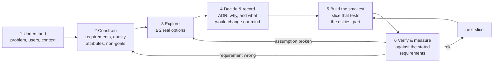

# 01 — Thinking Like a Senior Engineer

> **Mental model:** *a senior engineer optimises for the cost of change over the life of the system, under explicitly stated constraints, and makes the reasoning visible so others can check it.*
>
> Juniors ask "how do I make this work?". Seniors also ask "what will it cost to change this later, who pays, and how will we know if it's wrong?".

---

## 1. The problem: how projects actually go wrong

Almost no project fails because someone couldn't write a loop. They fail because of decisions made implicitly. Each of the following happened in SplatScope's GPU branch ([review](../gpu-forward-pass/01-code-review.md)):

| Junior habit | What it looked like in SplatScope | What it cost |
|---|---|---|
| **Solution first, problem later** | Writing kernels before deciding the coordinate conventions | A view matrix with det = −1, hidden by a second flip (review B1) |
| **Implicit assumptions** | `const Scene* scene_`: "the scene will outlive the renderer" | A lifetime rule enforced only by member declaration order |
| **Copying without understanding** | Half of the reference's glm row/column trick | Transposed covariance projection (A5) |
| **Not measuring** | `cudaMalloc`/`cudaFree` every frame | Device-wide stalls that make every later timing meaningless |
| **Two sources of truth** | The tile rectangle computed in two kernels | Out-of-bounds writes (A4) |
| **Resource release as a separate manual step** | `free_scene()` / `free_scratch()` | Leaks that grow with every new buffer (C1) |

None of these is a "skill" bug. Each is a **thinking** bug, and the habits below prevent them.

---

## 2. The senior engineering loop



The loop is cheap when it's fast. A senior engineer goes round it in hours for small decisions and in days for big ones. The important part isn't the steps themselves. It's that **step 6 can send you back to steps 2 or 3**, and you budgeted for that.

---

## 3. Requirements: say what "good" means before building

### 3.1 Functional vs non-functional

- **Functional requirements:** what the system *does*. "Load an official 3DGS PLY; render it from an orbit camera; evaluate SH up to degree 3."
- **Non-functional requirements (quality attributes):** how *well* it does it. Performance, correctness, maintainability, testability, debuggability, portability, observability, security, usability.

Architecture is mostly driven by the **non-functional** ones. Almost any architecture can *render a PLY*. Only some can do it while staying debuggable, testable against an oracle, and within 4 GB.

### 3.2 Quality-attribute scenarios: making "fast" and "maintainable" testable

A vague requirement ("should be fast") can't be designed against. A **scenario** has six parts. Write one for each attribute you care about:

```
 Source ──▶ Stimulus ──▶ Artifact ──▶ Environment ──▶ Response ──▶ Response measure
 (who)      (what)       (which part) (conditions)    (what happens) (how we know)
```

SplatScope examples:

| Attribute | Scenario |
|---|---|
| Performance | *User* orbits (*stimulus*) the *GPU renderer* (*artifact*) on a 3M-Gaussian scene at 1280×720 on a GTX 1650 Max-Q, AC power (*environment*); frames render (*response*) with **p95 GPU time ≤ 33 ms** (*measure*) |
| Correctness | *A developer* changes a kernel; the *test suite* runs; GPU output matches the CPU oracle with **PSNR ≥ 45 dB on 10 golden poses** |
| Debuggability | *A kernel* writes out of bounds; in a *Debug build* the failure is reported **naming the kernel**, within one frame |
| Modifiability | *A contributor* adds a new debug view; **≤ 2 files change**, and no change is needed in the app layer |
| Robustness | *A user* opens a truncated or hostile PLY; the loader **rejects it with a message**; no crash, no out-of-bounds read |
| Memory | *A 6M-Gaussian SH3 scene* is loaded on the 4 GB GPU; it renders, or **fails at load time with a clear "doesn't fit" message**, never OOMs mid-frame |

### 3.3 Prioritise, because attributes conflict

Performance fights debuggability (fused kernels are fast and opaque). Flexibility fights simplicity. Write the order down:

```
SplatScope priority order (a learning project):
  1. Learning value / clarity   — every concept lives in one visible place
  2. Correctness                — verifiable against an oracle
  3. Debuggability              — every intermediate buffer can be looked at
  4. Performance                — good, measured, explainable; not maximal
  5. Portability / extensibility — only where cheap (CPU-only build, loader contract)
```

When two designs tie, this list breaks the tie. A production renderer would put performance at #1 and clarity lower, and would end up with a *different architecture* from the same requirements. That's the point: **architecture follows from priorities**, not from taste.

### 3.4 Goals, non-goals, constraints, assumptions

| Kind | Definition | SplatScope |
|---|---|---|
| **Goals** | What success means | Correct forward pass, SH3, interactive on the target laptop, a codebase that teaches |
| **Non-goals** | What we deliberately *won't* do (as important as goals) | Training/backward pass, multi-GPU, Windows/macOS, maximum FPS, a GUI framework |
| **Constraints** | Fixed facts we can't change | GTX 1650 Max-Q (4 GB, sm_75), Linux, Optimus hybrid graphics, C++/CUDA, single developer |
| **Assumptions** | Things we *believe* but haven't verified | "Scenes fit in 4 GB at fp32", "L ≈ 4·N at 720p", "Phase A readback isn't a bottleneck" |
| **Risks** | Assumptions that would hurt if wrong | L explodes when zooming in → OOM; GL context on the iGPU → no interop |

**Senior habit:** every assumption gets a *test or a measurement* that would falsify it, scheduled early. "L ≈ 4·N" gets verified the day binning works, by putting L in the window title.

---

## 4. Trade-off thinking

### 4.1 There is no "best", only "best for these priorities"

For every option, list:

1. **What it optimises.**
2. **What it costs:** complexity, performance, flexibility, time.
3. **What would make you change your mind.** This is the most valuable line, and the one most often missing.

### 4.2 One-way and two-way doors

Some decisions are cheap to reverse (*two-way doors*); others are expensive or impossible to reverse (*one-way doors*). Spend design effort in proportion.

```
          cost to reverse ▲
                          │  ONE-WAY DOORS: slow down,        │  write an ADR, prototype,
                    high  │  public API, file formats,        │  get review
                          │  memory layout baked into kernels,│
                          │  dependency on a big framework    │
                          ├───────────────────────────────────┤
                          │  TWO-WAY DOORS: decide fast,      │  just pick, note it,
                     low  │  private function names, which    │  move on
                          │  CUB algorithm, tile size constant│
                          └───────────────────────────────────┴──────────▶
                                   low                          high   uncertainty
```

In SplatScope:

- **One-way(-ish):** `HostScene` as the format contract; the `IRenderer` boundary; coordinate conventions; the SH memory order the kernels assume; making CUDA a hard dependency of the whole build (today's CMake).
- **Two-way:** the 1.5× growth factor; 16×16 tiles (it's a `constexpr`); fp32 vs fp16 *if* it's hidden behind the scene buffer type.

**The trick seniors use: turn one-way doors into two-way doors** by putting a seam (an interface, a type, a single function) at the decision point. The SH storage precision is a one-way door if `float*` is hard-coded in five kernels. It's a two-way door if all access goes through one `load_sh_coeff(idx, k)` function.

### 4.3 Coupling, cohesion and "deep modules"

- **Coupling:** how much module A must know about B to work. Low is good.
- **Cohesion:** how strongly the contents of one module belong together. High is good.
- **Deep module** (John Ousterhout's term): a *small interface* hiding a *large implementation*. `GpuRenderer` is a deep module: four methods hide streams, eight kernels, a radix sort and about a dozen buffers. A *shallow* module has an interface about as complex as its implementation (a class with 20 getters), so it adds cognitive load without hiding anything.

```
 deep module                      shallow module
 ┌──────────┐ ← small interface   ┌──────────────────────────┐ ← big interface
 │          │                     │                          │
 │          │                     └──────────────────────────┘ ← little behind it
 │  lots of │
 │ hidden   │
 │ behaviour│
 └──────────┘
```

**Change amplification** is the symptom of bad coupling: one conceptual change forces edits in many places. Adding a buffer today means editing the struct, `alloc_*`, `free_*` and the kernel signature. That's four places for one concept. With RAII `DeviceBuffer` members and args structs it becomes two.

### 4.4 YAGNI vs designing seams

- **YAGNI** ("You Aren't Gonna Need It"): don't build generality for imagined futures. A plugin system for scene formats you don't have yet is YAGNI.
- But **a seam is not generality**. A seam is a *place* where change is cheap: a function boundary, an interface, a contract type. `HostScene` as the loader contract costs almost nothing today and makes "add a format later" a local change.
- **Rule of three:** write it once; copy it the second time (noting the duplication); abstract it the third time, when you can see what actually varies.

### 4.5 Make it work → make it right → make it fast

The order matters. *Work*: a vertical slice proves the concept. *Right*: correct, tested, clean ownership. *Fast*: measured optimisation. **Fast before right** gives you a fast wrong answer, and you can't tell how wrong. That's why the plan puts the CPU oracle and conventions (M0/M1) before any optimisation.

---

## 5. Invariants: the most underrated senior habit

An **invariant** is a statement that is always true at certain points in the program. Seniors *name* invariants, *enforce* them at boundaries, and *assert* them in debug builds.

| Kind | SplatScope example | Enforced where |
|---|---|---|
| Data invariant | All `HostScene` arrays have length N; every value is finite; quaternions are normalised | `HostScene::validate()` at the end of loading: the boundary |
| Pipeline invariant | `radius[i] == 0 ⇔ tiles_touched[i] == 0 ⇔ culled` | Preprocess writes every slot; a debug check after preprocess |
| Inter-stage invariant | Duplicate writes exactly `tiles_touched[i]` keys for Gaussian i | Shared `get_tile_rect`; device `assert(off == offsets[i])` |
| Ownership invariant | Each device allocation has exactly one owner | `DeviceBuffer` copy deleted |
| Convention invariant | det(R) = +1; image row 0 is the top | Unit test; one flip in the presenter |

**The habit:** when you write a data structure or stage, finish the sentence "this is always true about it: …". If you can't, the design isn't finished.

---

## 6. Failure-first thinking: the pre-mortem

Before building, imagine it's six months later and the project failed. Write down *why*. Then design against the top items.

SplatScope pre-mortem (example):

| "It failed because…" | Likelihood | Mitigation designed in |
|---|---|---|
| GPU and CPU images disagree, and we can't tell which is wrong | High | Shared `SPLAT_HD` maths; stage-by-stage comparison; debug views |
| It crashes on big scenes after a few minutes of zooming | Medium | L cap from `cudaMemGetInfo`; `FrameStats` status; graceful degradation |
| Every change breaks something unrelated | Medium | Layered dependencies, tests per layer, CI |
| Optimisations made it unreadable and nobody knows which ones helped | Medium | Experiment log (module 08); each optimisation behind a flag with a measured result |
| Interop never works on the laptop | High (Optimus) | Phase A as default; runtime selection |
| I lost motivation before seeing a GPU image | Medium | The naïve vertical slice between M2 and M3 |

---

## 7. Writing it down: design docs and ADRs

### 7.1 The design doc (one per significant feature)

```
# <Feature> — Design
Status: draft | in review | accepted        Author / date
1. Context & problem         — what is wrong or missing, for whom
2. Goals / non-goals
3. Requirements              — functional + quality-attribute scenarios
4. Options considered        — ≥ 2, each with pros/cons/cost
5. Proposed design           — diagrams first (context, components, sequence, ownership)
6. Data & memory             — owners, lifetimes, layouts, budget
7. Failure modes & testing   — pre-mortem, invariants, how we verify
8. Rollout / migration       — how we get from current code to this
9. Open questions
```

The documents in `docs/gpu-forward-pass/` are a large design doc split into chapters. Compare them with this template.

### 7.2 Architecture Decision Records (ADRs)

An ADR captures **one** decision. It's short (one page), numbered, never edited after acceptance (you write a new ADR that *supersedes* it), and kept in the repo next to the code (`docs/adr/`). The widely used format comes from Michael Nygard:

```
# ADR-NNN: <decision as a short noun phrase>
Status: proposed | accepted | superseded by ADR-MMM
Date:

## Context      — forces at play: requirements, constraints, priorities
## Options      — each with pros / cons (seniors always list ≥ 2)
## Decision     — "We will …" (active voice, one paragraph)
## Consequences — good, bad, and what would make us revisit this
```

**Worked example:**

> **ADR-001: Backends behind a virtual `IRenderer` interface; presentation separated from rendering**
> *Status:* accepted.
> *Context:* We need a CPU oracle and a GPU renderer that produce comparable images from identical inputs. Today each renderer owns its own `Display` (GL objects), so switching at runtime would duplicate GL state. Priority #1 is clarity; #2 is correctness.
> *Options:* (a) virtual interface; (b) `std::variant`; (c) compile-time backend template; (d) keep presentation inside the renderers.
> *Decision:* We will define `IRenderer::render(const FrameRequest&, const ImageView&) -> FrameStats`. CPU and GPU implement it. A separate `Presenter` owns all GL objects.
> *Consequences:* + runtime A/B toggle; + renderers testable headless (no GL needed). − one virtual call per frame (negligible). − the renderer can't use GL-specific tricks without going through `ImageView`. **Revisit if** a backend needs to render directly into GL resources in a way `ImageView` can't express.

---

## 8. Slicing the work

- **Walking skeleton:** the thinnest end-to-end version that touches every layer (load → camera → render → present), even if each part is trivial. It proves the architecture connects before anything is deep.
- **Vertical slices over horizontal layers:** "SH degree 1 end-to-end (loader → kernel → hotkey → test)" beats "finish the whole loader, then the whole kernel layer". Each slice is demonstrable and testable.
- **Riskiest first:** if interop on Optimus might be impossible, find out in week 1, not week 10.

```
 Horizontal (risky)                 Vertical slices (preferred)
 ┌───────────────────────┐          ┌────┬────┬────┬────┐
 │ all of loader         │          │ S1 │ S2 │ S3 │ S4 │  S1 = walking skeleton
 ├───────────────────────┤          │    │    │    │    │  S2 = tiles end-to-end
 │ all of GPU pipeline   │          │    │    │    │    │  S3 = SH1 end-to-end
 ├───────────────────────┤          │    │    │    │    │  S4 = SH3 + fp16
 │ all of presentation   │          │    │    │    │    │
 └───────────────────────┘          └────┴────┴────┴────┘
  nothing works until the end        something works after every slice
```

---

## 9. Apply to SplatScope

**Step 1: write the design brief** (`docs/design-brief.md`, about one page):
- Problem statement (two sentences).
- Goals and non-goals (§3.4).
- The priority order (§3.3).
- Five quality-attribute scenarios (§3.2), with *numbers*.
- Constraints, assumptions and risks, with how and when each assumption will be checked.

**Step 2: create `docs/adr/`** and write:
- ADR-001: renderer abstraction (the example above, in your own words).
- ADR-002: coordinate conventions (OpenCV camera, image row 0 = top, one flip at presentation).
- ADR-003: ownership policy (RAII everywhere; owners vs views; no raw owning pointers).
- ADR-004: presentation path on Optimus (readback default, runtime interop selection).
- ADR-005: SH storage (fp32 now, fp16 option behind one access function).

**Step 3: run a pre-mortem** (§6) and add your own rows.

**Checkpoint:** someone who has never seen the code can read the brief and the ADRs and correctly answer:
- Why is there a CPU renderer?
- Why isn't interop the default?
- What happens on a scene that doesn't fit in VRAM?

---

## 10. The senior lens: questions to ask about any design

- What problem does this solve, *for whom*, and how will we know it's solved?
- What are the top 2–3 quality attributes, and which one loses when they conflict?
- Which parts of this decision are one-way doors? Can we add a seam to make them two-way?
- What's the simplest design that meets the requirements? What does the next-simplest add, and do we need it *now*?
- What are the invariants? Where are they enforced?
- Who owns each resource, and what's its lifetime? (Module 03.)
- How does this fail? How will we *find out* it failed?
- What would make us change this decision?
- What's the smallest slice that tests the riskiest assumption?

---

## 11. Interview probes

| Question | What they're really checking | Strong answer shape |
|---|---|---|
| "Tell me about a technical trade-off you made." | Do you see costs, not just benefits? | Context → ≥ 2 options → criteria → decision → *what it cost* → what you'd revisit |
| "How do you decide when to abstract?" | YAGNI vs seams | Rule of three; seams at one-way doors; abstraction cost is a real cost |
| "How do you approach a performance problem?" | Measurement discipline | Requirement with a number → profile → hypothesis → one change → re-measure (module 08) |
| "What's a non-functional requirement you designed for?" | Architecture follows quality attributes | A quality-attribute scenario with a measure |
| "How do you make a decision reversible?" | One-way vs two-way doors | Put an interface or contract type at the decision point; keep it behind one function |
| "How do you document decisions?" | Team scaling | ADRs: short, immutable, superseded rather than edited |
