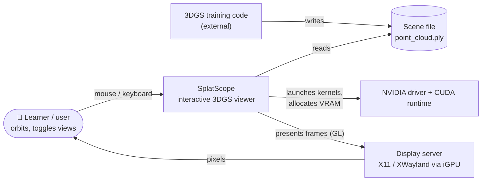
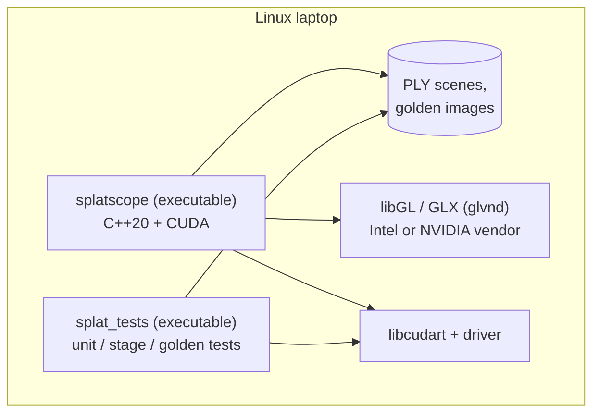
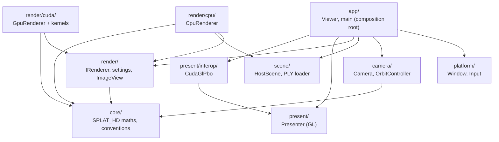
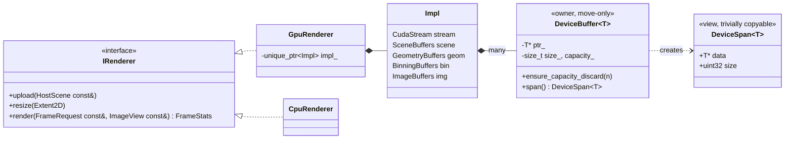
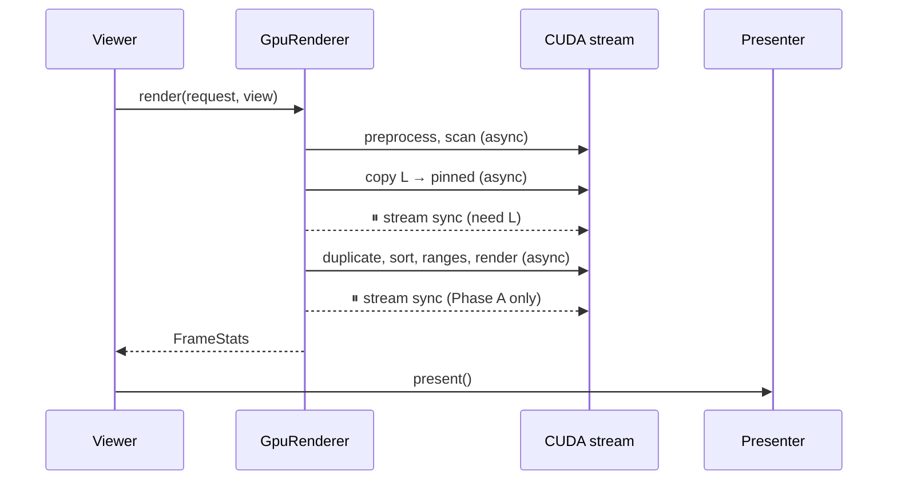
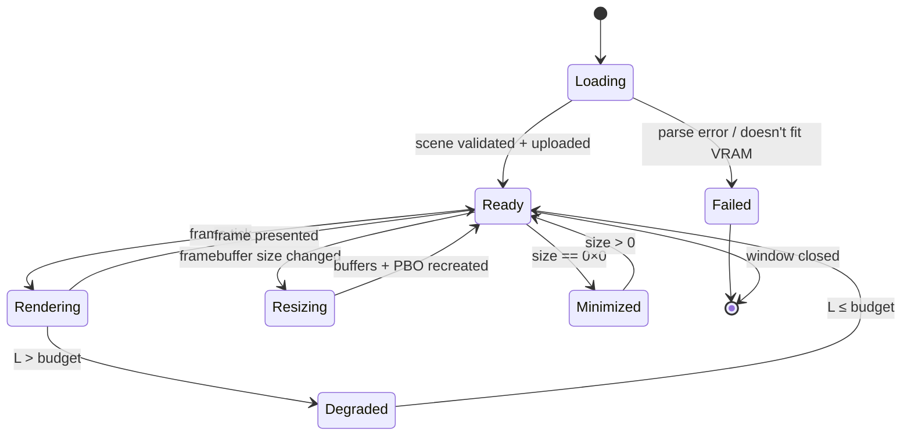
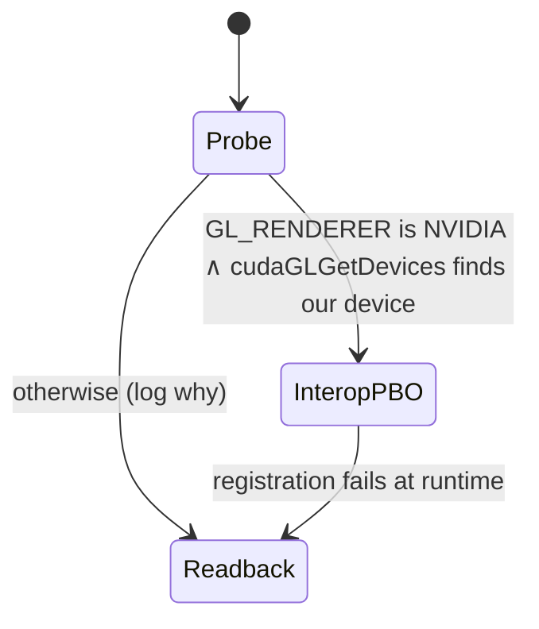
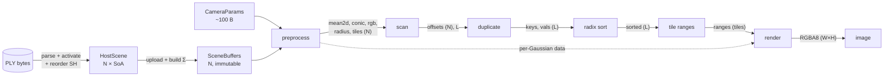
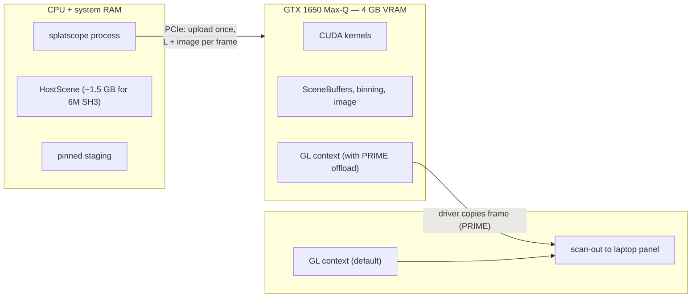

# 02 — Diagrams as Thinking Tools

> **Mental model:** *every diagram answers exactly one question. Pick the question first, then the diagram type that answers it, then draw only what the question needs.*
>
> A diagram that tries to show everything (classes + data flow + threads + memory) answers nothing. Seniors carry a small toolbox of diagram types and know which question each one answers.

---

## 1. The problem: why most architecture diagrams are useless

The typical "architecture diagram" is a cloud of boxes with unlabelled arrows. Common failure modes:

- **Mixed semantics:** one arrow means "calls", the next "owns", the next "sends data to". The reader can't tell which.
- **Mixed zoom levels:** a box for "the GPU" next to a box for `get_tile_rect()`.
- **No question:** the diagram exists because a diagram was expected, not because it answers something.
- **Stale:** drawn once in a slide tool and never updated. It now lies.

The cure: a **fixed set of diagram types**, each with one question and one notation, kept **as code in the repo** so they're reviewed and updated like code.

---

## 2. The toolbox: question → diagram

| Question | Diagram | Notation used here |
|---|---|---|
| What is the system, and what does it interact with? | **C4 Level 1: System context** | flowchart |
| What separately runnable or deployable pieces exist? | **C4 Level 2: Container** | flowchart |
| What are the major parts inside, and which depends on which? | **C4 Level 3: Component / dependency graph** | flowchart |
| What types exist, and how are they related? | **UML class diagram** (C4 Level 4) | `classDiagram` |
| **Who owns what, and how long does it live?** | **Ownership tree + lifetime bars** | classDiagram + ASCII |
| In what order do things happen? | **Sequence diagram** | `sequenceDiagram` |
| What modes can the system be in, and what moves it between them? | **State machine** | `stateDiagram-v2` |
| How does data transform from input to output? | **Data-flow / pipeline diagram** | flowchart |
| How are the bytes laid out? | **Memory-layout diagram** | ASCII |
| When does each thing run, on which processor? | **Timeline** | ASCII / `gantt` |
| Where does each thing physically live and run? | **Deployment diagram** | flowchart |

**The C4 model** (Simon Brown) is the most widely recognised way to organise the first four: **C**ontext → **C**ontainers → **C**omponents → **C**ode, each zooming in on one box of the level above. Engineers from other teams will recognise it immediately.

```
 Level 1  Context      [ user ] ──▶ [ SplatScope ] ──▶ [ GPU driver ] ...
                                         │ zoom
 Level 2  Containers              [ splatscope exe ] [ PLY files ] [ display server ]
                                         │ zoom
 Level 3  Components         [ scene ] [ camera ] [ render/cuda ] [ present ] ...
                                         │ zoom
 Level 4  Code                    class GpuRenderer { … }  class DeviceBuffer<T> { … }
```

---

## 3. The SplatScope diagram set, drawn

Each of these is a target for you to *redraw yourself* (§6). They show the intended architecture from [`gpu-forward-pass/02`](../gpu-forward-pass/02-architecture.md).

### 3.1 C4 Level 1: system context

*Question: what is SplatScope, and what does it talk to?*



### 3.2 C4 Level 2: containers

*Question: what are the separately runnable or deployable pieces?* For a desktop app, "containers" are the executable, its data stores and its runtime dependencies. A web system would show services and databases here.



### 3.3 C4 Level 3: components and dependency direction

*Question: which parts depend on which?* **Arrows mean "depends on" (includes or uses its API).** They point *down* the layers.



> **Dependency direction ≠ data-flow direction.** Pixels flow *from* the renderer *to* the presenter, yet neither depends on the other: both depend on `ImageView`, and only `app/` connects them. Mixing these two meanings is the single most common diagram mistake. Draw them as **separate diagrams**.

### 3.4 Class diagram, with ownership semantics

*Question: what types exist, and how are they related?*



### 3.5 Ownership tree + lifetime bars

*Question: who owns what, and how long does each thing live?* This isn't a standard UML diagram, but it's the most useful one for C++ systems work.

**Ownership tree** (every node has exactly one owning parent; `⇢` is a borrow):

```
Viewer ⟨owner of everything below⟩
├── GlfwRuntime
├── Window ──────────────── owns GLFWwindow* + GL context
├── shared_ptr<const HostScene> ═══╗ shared with CpuRenderer
├── Presenter ───────────── owns GlTexture, GlBuffer(PBO), GlProgram, VAO
├── optional<CudaGlPbo> ─── owns cudaGraphicsResource_t  ⇢ borrows Presenter's PBO name
├── unique_ptr<IRenderer>
│   └── GpuRenderer::Impl
│       ├── CudaStream
│       ├── SceneBuffers    { DeviceBuffer<Vec4f> mean_opacity, … }
│       ├── GeometryBuffers { … }   BinningBuffers { … }   ImageBuffers { … }
│       └── PinnedBuffer<uint32_t> num_instances
├── Camera   (value)
└── OrbitController (value)

per frame:  MappedPbo ⟨lease⟩ ⇢ CudaGlPbo   (lives for one scope)
            ImageView ⟨view⟩  ⇢ PBO memory or image buffer
```

**Lifetime bars** (time runs to the right; construction order top to bottom, destruction in reverse):

```
time ─────────────────────────────────────────────────────────────────────────▶
GlfwRuntime   ████████████████████████████████████████████████████████████████
Window/GLctx    ████████████████████████████████████████████████████████████
HostScene         ██████████████████████████████████████████████████████████
Presenter (GL)      ██████████████████████████████████████████████████████
CudaGlPbo             ██████████████████████████████████████████████████
GpuRenderer             ██████████████████████████████████████████████
  per-frame lease          ▌ ▌ ▌ ▌ ▌ ▌ ▌ ▌ ▌ ▌ ▌ ▌ ▌ ▌ ▌ ▌ ▌ ▌ ▌ ▌ ▌
                       ▲ each bar must lie entirely inside the bars of everything it depends on
```

**The rule this diagram makes visible:** a resource's bar must be **nested inside** the bars of everything it depends on. GL objects sit inside the GL context; the interop registration sits inside the PBO; device buffers sit inside the CUDA context. If you can't draw it nested, you have a lifetime bug.

### 3.6 Sequence diagram

*Question: in what order do things happen within one frame?* The full version is in [`gpu-forward-pass/02 §5`](../gpu-forward-pass/02-architecture.md#5-per-frame-control-flow). The pattern to notice: **sync points are drawn explicitly**, because they're where the CPU waits.



### 3.7 State machine

*Question: what modes can the application be in, and what moves it between them?* State machines turn scattered `if (minimized && !loading && ...)` checks into explicit, reviewable logic.



A second, smaller state machine decides the presentation path at startup (module 05 §State):



### 3.8 Data-flow / pipeline diagram

*Question: how does data change shape from input to output?* Label the **data** on the arrows, and the transformation in the boxes.



### 3.9 Memory-layout diagram

*Question: how are the bytes arranged, and what does one warp touch?* Module 06 goes deeper.

```
SoA: mean_opacity (Vec4f, 16 B each)          warp of 32 threads, thread i reads element i
 ┌────────┬────────┬────────┬────────┬─────┬────────┐
 │ G0 xyzo│ G1 xyzo│ G2 xyzo│ G3 xyzo│ ... │G31 xyzo│  = 512 contiguous bytes
 └────────┴────────┴────────┴────────┴─────┴────────┘    = exactly 4 × 128-byte lines ✅
 |←────────── line 0 ────────→|←── line 1 ──→| ...

AoS: struct { Vec3f mean; Vec3f scale; Vec4f quat; float opacity; … } (≈ 60 B)
 ┌───────────────────────────┬───────────────────────────┬────
 │ G0: mean scale quat op …  │ G1: mean scale quat op …  │ ...  reading only `mean`:
 └───────────────────────────┴───────────────────────────┴────  32 × 12 B used out of
   ^^^^ used                   ^^^^ used                         ~32 × 60 B fetched ❌
```

### 3.10 Timeline

*Question: when does each thing run, and where does the CPU wait?*

```
           frame N                                                   frame N+1
CPU   │poll│ctrl│ launch pre+scan │wait L│ launch dup/sort/rng/rend │wait│present│swap│poll│…
GPU   │    │    │ █preprocess█scan│      │ █dup█ ███sort███ █rng█ ████render████ │cp│     │
PCIe  │    │    │                 │▌4 B  │                                       │▌img│   │
                                    ▲ sync #1                                   ▲ sync #2 (Phase A)
```

### 3.11 Deployment diagram

*Question: where does each thing physically live?* This matters on the Optimus laptop.



---

## 4. Rules for good diagrams

1. **One question per diagram, written as its title.**
2. **One meaning per arrow type,** with a legend if it isn't obvious. Label arrows with a verb or the data that flows.
3. **One zoom level per diagram.** Don't put a function next to a subsystem.
4. **Seven ± two boxes.** If there are more, you're at the wrong zoom level. Split it or group it.
5. **Show the dangerous things explicitly:** sync points, ownership transfers, the one place a convention flips, resources that cross a boundary.
6. **Diagrams live in the repo as code**, next to what they describe, and change in the same PR as the code.
7. **A diagram that disagrees with the code is a bug.** Fix whichever is wrong.

---

## 5. Alternatives: diagram tooling

| Tool | Pros | Cons | Use for |
|---|---|---|---|
| **Mermaid** (used here) | Text in Markdown; GitHub renders it; diffable; reviewable | Limited layout control; complex diagrams get messy | Most diagrams in the repo |
| **ASCII art** | Renders everywhere (terminal, code comments, any viewer); total control | Tedious to edit | Memory layouts, timelines, diagrams inside source comments |
| PlantUML | Full UML; better layout than Mermaid | Needs a renderer (Java or a server); GitHub doesn't render it natively | Large UML models |
| Structurizr DSL | Purpose-built for C4; one model, many generated views | Another tool and syntax | Teams that use C4 seriously |
| Graphviz (dot) | Excellent automatic layout for graphs | Not Markdown-native | Generated dependency graphs (e.g. CMake's `--graphviz` output) |
| Excalidraw / whiteboard | Fastest for *thinking*; best in discussions | Binary or images; drifts from code | Exploring before committing to a design |
| draw.io / slide tools | Polished visuals | Not diffable; goes stale fastest | Presentations only |

**A senior workflow:** sketch on a whiteboard or in Excalidraw to *think*, then commit a Mermaid or ASCII version to *record*.

**Tip:** `cmake --graphviz=deps.dot` generates the target dependency graph from your real build. Compare it with your intended §3.3 diagram, and any difference is an architecture violation.

---

## 6. Apply to SplatScope

**Step 1:** create `docs/architecture/` with one Markdown file per diagram type from §2. Redraw each one *yourself*; don't copy them. Redrawing is where the understanding happens.

**Step 2:** draw the **current** code (on the `gpu_renderer` branch) and the **target** architecture side by side, for at least the component (§3.3) and ownership (§3.5) diagrams. The differences between the two are your refactoring plan.

**Step 3:** add a lifetime-bar diagram (§3.5) and check by eye that every bar is nested inside what it depends on.

**Step 4:** after the CMake restructure (module 09, phase 0), generate the CMake dependency graph and compare it with §3.3.

**Checkpoint:** for each diagram, a reader can answer its title question in under 30 seconds without asking you anything.

---

## 7. The senior lens

- What question does this diagram answer? Is it in the title?
- Does every arrow have exactly one meaning?
- Where are the sync points, ownership transfers and convention flips? Are they visible?
- Does the generated dependency graph agree with the intended one?
- When did this diagram last change, and has the code changed since?

## 8. Interview probes

| Question | Strong answer |
|---|---|
| "Draw the architecture of a system you built." | Start with context (L1), zoom one level at a time, state the question each picture answers, and point out the riskiest boundary |
| "What's the difference between a dependency arrow and a data-flow arrow?" | Dependency means compile-time knowledge (who includes whom). Data flow means runtime movement. They often point in opposite directions, and good architecture makes dependencies point toward stable abstractions |
| "How do you keep diagrams up to date?" | Diagrams as code in the repo, changed in the same PR as the code, plus generated diagrams to cross-check |
| "Composition vs aggregation in UML?" | Composition: the part's lifetime is bound to the whole (unique ownership). Aggregation: the whole holds the part without controlling its lifetime (shared or borrowed) |
