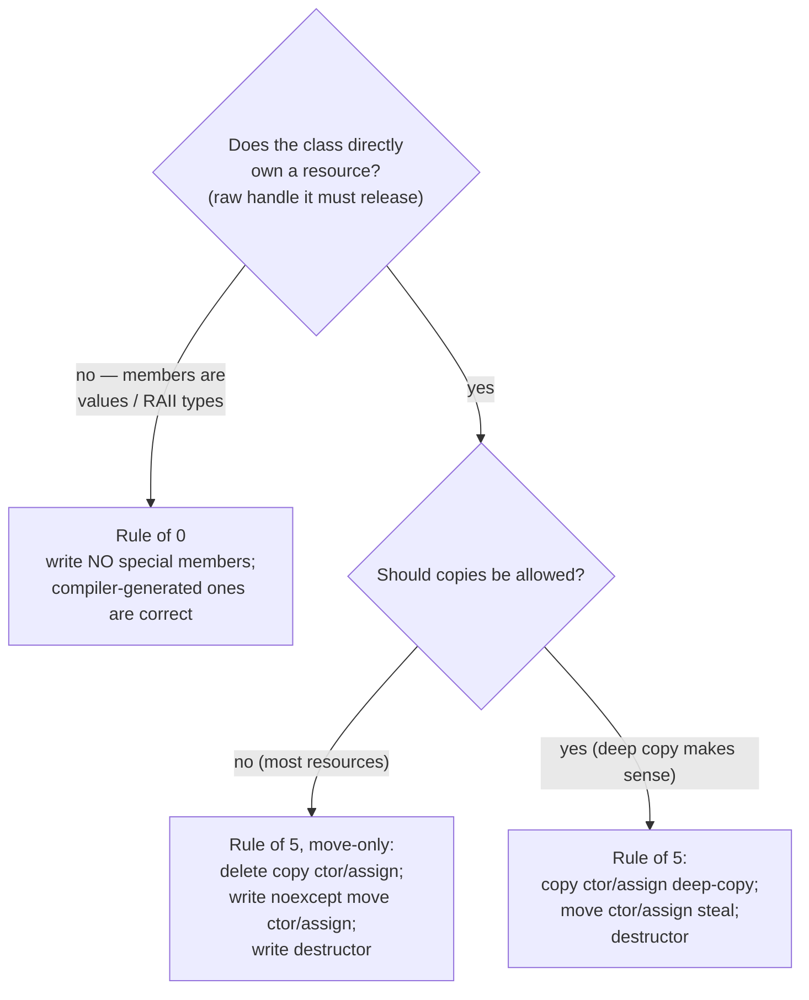

# 03 — Memory Ownership from First Principles

> **Mental model:** *every resource has exactly one owner responsible for releasing it. Everyone else **borrows**, and a borrow must never outlive the owner. In C++, ownership is a lifetime problem that you encode in **types**, so the compiler enforces what comments merely hope for.*

"Resource" means anything acquired that must be released: heap memory, device memory, pinned memory, an OpenGL name, a GLFW window, a CUDA stream, a mapped interop pointer, a file, a lock.

---

## 1. The problem: the six ownership bugs

```
              acquire ──────────── use ──────────── release
                 │                  │                  │
   ① leak:       ●──────────────────●──────────────────✗ never released
   ② double free:●──────────────────●──────────────────●●  released twice
   ③ use-after-free (dangling):  ●────────●  release   ●  …use  ✗
   ④ use-before-init:     use ✗  ●────────────────────●
   ⑤ invalidation:  view taken ─▶ owner reallocates ─▶ view now dangles
   ⑥ data race:     two users, at least one writing, no ordering between them
                    (CPU thread vs CPU thread, OR host vs GPU stream)
```

Every one of these has happened, or is latent, in SplatScope's current code:

| Bug | Where ([review](../gpu-forward-pass/01-code-review.md)) |
|---|---|
| ① Leak | `free_scene` misses `d_cov3d`; `free_scratch` misses `d_cub_temp`; `set_scene` twice leaks everything (C1) |
| ② Double free | `GpuRenderer`, `Display`, `Shader`, `Window` are copyable; any copy frees twice (C3) |
| ③ Dangling | `const Scene* scene_` if `Viewer`'s members are reordered (C5); `Window` moved while GLFW holds `this` |
| ④ Use-before-init | Device buffers read before any write: `radii`, `tiles_touched` (A2); `render()` before `set_scene()` |
| ⑤ Invalidation | `reinterpret_cast<const float*>(vector.data())` pointers are only valid until the vector reallocates |
| ⑥ Race (host vs device) | In Phase A, if the host reads the pinned image before the stream has finished copying into it |

---

## 2. First principles: storage and lifetime in C++

### 2.1 Four storage durations

| Duration | Created | Destroyed | Example |
|---|---|---|---|
| **Automatic** (stack) | When execution reaches the declaration | When the scope exits (reverse order) | `Camera camera;` in a function |
| **Static** | Before `main` (or on first use, for function-local statics) | After `main` returns (reverse order of construction) | Globals. **Never put CUDA or GL resources here**: their runtime may already be gone when the destructor runs |
| **Thread** | When the thread starts | When the thread ends | `thread_local` |
| **Dynamic** (heap) | `new` / allocator | Explicitly (`delete`), or by an owning object | `std::vector`'s buffer, `unique_ptr`'s object |

**Members** have the lifetime of their enclosing object: constructed in declaration order, destroyed in **reverse** declaration order. That rule is the backbone of everything below.

### 2.2 A resource is not the same as the object that refers to it

```
  Stack (automatic)                Heap / VRAM / driver (the actual resource)
 ┌──────────────────────┐          ┌──────────────────────────────┐
 │ DeviceBuffer<float> b│          │ 64 MB of VRAM                │
 │  ptr_  ──────────────┼─────────▶│ (allocated by cudaMalloc)    │
 │  size_, capacity_    │          └──────────────────────────────┘
 └──────────────────────┘
   24 bytes; trivial to copy        the resource the object *refers to*:
   the *handle*                     who releases it?
```

Copying the handle doesn't copy the resource. This is where double frees come from: two handles, one resource, two destructors. **Ownership answers: which handle is responsible for the release?**

---

## 3. RAII: tie the release to a destructor

**Resource Acquisition Is Initialization:** acquire in the constructor, release in the destructor. Because C++ runs destructors *deterministically*, on every exit path including exceptions, the release can't be forgotten.

```
 void Viewer::init() {
     Window      w{…};        // ① acquires GL context
     Presenter   p{…};        // ② acquires GL objects
     GpuRenderer r{…};        // ③ throws (out of memory)
 }                            // stack unwinding runs: ~p() then ~w(). Nothing leaks.
          ③ throw ──▶ unwind ──▶ ~Presenter (② released) ──▶ ~Window (① released)
```

Compare today's code: `rasterizer::upload(...)` aborts on failure, and anything allocated before the abort is simply abandoned. In a long-running process (or a test suite that expects the error), that's a leak.

**The senior rule:** *no naked release calls.* If you write `cudaFree`, `glDelete*` or `glfwDestroyWindow` outside a destructor, there's an ownership bug waiting to happen.

---

## 4. The ownership vocabulary

### 4.1 The roles

| Role | Meaning | C++ spelling | SplatScope example |
|---|---|---|---|
| **Unique owner** | Sole responsibility for release; movable, not copyable | Value member; `std::unique_ptr<T>`; your own move-only RAII type | `DeviceBuffer<T>`, `GlTexture`, `unique_ptr<IRenderer>` |
| **Shared owner** | Released when the last owner lets go | `std::shared_ptr<T>` | `shared_ptr<const HostScene>` |
| **Borrower (reference)** | Uses something owned elsewhere; must not outlive it | `T&`, `const T&`, non-owning `T*` | `render(const FrameRequest&, …)` |
| **View** | A borrow of a *range* of memory; trivially copyable | `std::span<T>`, `std::string_view`, `DeviceSpan<T>`, `ImageView` | Kernel arguments |
| **Weak observer** | Can check whether a shared object still exists | `std::weak_ptr<T>` | (not needed in SplatScope) |
| **Lease** | Temporary access that must be returned; tied to a scope | A RAII guard object | `MappedPbo` (map in ctor, unmap in dtor), `std::lock_guard` |
| **Handle / index** | An integer that refers into a table owned elsewhere | `uint32_t id`, generational handles | Gaussian ids in `point_list`; GL names (`GLuint`) |

### 4.2 Reading ownership from a function signature

The C++ Core Guidelines convention, which most senior C++ engineers read fluently:

| Signature | What it says |
|---|---|
| `void f(Widget w)` | "I take my own copy (or a moved-in value) and own it" (a *sink*) |
| `void f(const Widget& w)` | "I read it; you keep owning it; it must live through the call" |
| `void f(Widget& w)` | "I modify it in place; you keep owning it" |
| `void f(Widget&& w)` | "I may steal its guts" (usually only for move constructors/assignment and perfect forwarding) |
| `void f(std::unique_ptr<Widget> w)` | "**Ownership transfers to me**." Caller must `std::move` |
| `void f(std::shared_ptr<Widget> w)` | "I will **keep a share** beyond this call." Costs an atomic increment |
| `void f(const std::shared_ptr<Widget>& w)` | Usually a smell: if you don't keep a share, take `const Widget&` |
| `void f(std::span<const float> s)` | "I read a range for the duration of the call" |
| `Widget* f()` | **Ambiguous.** Owning or not? Avoid in new code; return `unique_ptr` (owning) or a reference (non-owning) |
| `[[nodiscard]] Lease acquire()` | "You must hold the returned guard; dropping it releases immediately" |

**Exercise:** go through every public function in today's `src/` and rewrite its signature so ownership is unambiguous. `void set_scene(const Scene& scene)` that stores `&scene` is the classic lie: the signature says "borrow for the call", the body keeps the pointer.

---

## 5. Value semantics, the Rule of 0/3/5, and move semantics

### 5.1 Which special members to write



**The design goal is Rule of 0 for almost every class.** Only a handful of small *resource wrappers* (`DeviceBuffer`, `GlHandle`, `CudaStream`, `PinnedBuffer`, `Window`) own raw handles and need special members. Everything else (`SceneBuffers`, `GpuRenderer::Impl`, `Presenter`, `Viewer`) is composed of those wrappers, and gets correct copy, move and destruction behaviour for free. Today's code has the opposite: many classes owning raw handles, none with correct special members.

### 5.2 Move semantics from first principles

*Problem:* returning or passing a large owning object by value would copy the resource (expensive) or the handle (double free). *Solution:* a **move** transfers the resource and leaves the source in a valid but empty state.

```
 before move:                           after  DeviceBuffer b2 = std::move(b1);
 b1 { ptr_ ──▶ [VRAM block] }           b1 { ptr_ = nullptr }       ← valid, empty
                                        b2 { ptr_ ──▶ [VRAM block] } ← sole owner
 later: ~b2 frees the block; ~b1 frees nullptr (a no-op). Exactly one release. ✔
```

Key facts an interviewer will probe:

- **`std::move` moves nothing.** It's a cast to an rvalue reference (`T&&`) that *permits* the move constructor to be chosen.
- **A moved-from object must be destructible and assignable.** Its value is unspecified for standard types; for your own types, define it ("empty").
- **Mark moves `noexcept`.** `std::vector` uses `std::move_if_noexcept` when it reallocates: if the move constructor might throw and a copy constructor exists, it *copies* to keep the strong exception guarantee.
- **Self-move-assignment** (`a = std::move(a)`) must not free the resource before stealing it. Guard against it or use copy-and-swap.

### 5.3 When a type should not even be movable

Some objects have **identity**: their address is registered somewhere else. `Window` gives GLFW its `this` pointer for callbacks. Moving it changes `this` but not what GLFW stored. So `Window` is **non-copyable and non-movable**. If it must be relocated, put it in a `unique_ptr`, because the heap address doesn't change when the pointer moves.

```
 Window (on stack/in Viewer) ◀───── GLFW user pointer (stored copy of `this`)
     │ moved to new address ✗
     ▼
 Window' (new address)        GLFW still points at the old address → callbacks write into a dead object
```

---

## 6. Views and the dangling problem

A **view** (`span`, `string_view`, `DeviceSpan`, `ImageView`) is a pointer plus a size that **doesn't own**. Views are cheap and make APIs generic, but the view's validity is bounded by the owner's *and* by the owner's **reallocation**.

| Owner operation | Pointers, references, iterators and views into it |
|---|---|
| `std::vector::push_back` / `resize` / `reserve` that grows capacity | **All invalidated** |
| `std::vector::push_back` within capacity | Only `end()` invalidated |
| `DeviceBuffer::ensure_capacity_discard` that grows | **All `DeviceSpan`s invalidated** (and contents discarded) |
| `Presenter` recreates the PBO on resize | **The interop registration and any mapped pointer are invalid** |
| Owner destroyed | All invalidated |

**Rule:** take views *after* the last reallocation of the frame, use them within that frame (or call), and never store them in long-lived objects. In SplatScope, `render()` first calls `ensure_capacity_discard(L)`, *then* builds the args structs (which contain views), then launches. The order matters.

---

## 7. Shared ownership: when, and what it costs

`shared_ptr` is legitimate when **several owners genuinely need the object to live, and none can be designated as outliving the others**. Typical cases: immutable shared data (SplatScope's scene), asynchronous callbacks that may outlive their caller, caches.

Costs and traps:

- **An atomic reference count** on every copy (cheap, but not free; it contends under threads).
- **Lifetime becomes non-local.** "When is this freed?" now depends on the whole program.
- **Cycles leak:** A → B → A with `shared_ptr` both ways is never freed. Break cycles with `weak_ptr`.
- **`shared_ptr<T>` to mutable `T` is shared mutable state**, which means race conditions once threads exist.

**Pattern: `shared_ptr<const T>`.** Shared *and* immutable means there's no race, no defensive copying, and the type states clearly "nobody changes this". That's the scene ownership in SplatScope.

---

## 8. Ownership across C APIs: GLFW, OpenGL, CUDA

C libraries give you **handles** with paired create/destroy functions. Wrapping them is the most common systems-C++ task.

| Library handle | Kind | Wrapper approach |
|---|---|---|
| `GLFWwindow*` | Pointer | `std::unique_ptr<GLFWwindow, Deleter>` works (it's a real pointer). But SplatScope's `Window` also registers `this`, so a hand-written non-movable class is clearer |
| `GLuint` (texture, buffer, program) | **Integer**, not a pointer | Own move-only `GlHandle<Policy>` (`unique_ptr` needs a custom `pointer` type satisfying *NullablePointer*, which is awkward) |
| `void*` from `cudaMalloc` | Pointer | `DeviceBuffer<T>` (adds size, capacity and type) |
| `cudaStream_t`, `cudaEvent_t` | Opaque pointer | Move-only `CudaStream`, `CudaEvent` |
| `cudaGraphicsResource_t` | Opaque pointer, **depends on a GL object** | `CudaGlPbo` (registration lifetime) + `MappedPbo` (a lease) |

**Hidden dependency: contexts.** A `GLuint` is meaningful only while its GL context exists *and is current*. CUDA allocations belong to a CUDA context. So these wrappers have an **implicit parent**, and the lifetime-bar rule from module 02 applies: GL wrappers must be destroyed before the `Window` that owns the context. Encode that in member order, and comment it.

---

## 9. GPU memory ownership: the host owns, the device borrows, asynchrony complicates

```
   HOST (owners)                                          DEVICE (borrowers)
 ┌──────────────────────────────┐   launch with views  ┌──────────────────────────┐
 │ GpuRenderer::Impl            │ ───────────────────▶ │ kernel<<<…>>>(Args{      │
 │   DeviceBuffer<Vec4f> means  │   (pointer+size,     │    DeviceSpan<Vec4f> …}) │
 │   DeviceBuffer<uint64> keys  │    copied by value)  │  reads/writes VRAM       │
 └──────────────────────────────┘                      └──────────────────────────┘
          ▲ destructor frees VRAM                              never frees anything
```

**The new problem asynchrony creates: "in-flight" lifetime.** A kernel launch or `cudaMemcpyAsync` *returns immediately*. The GPU uses the memory *later*. So a resource must stay alive and unmodified until the GPU is done with it, not just until the launching call returns.

```
 host:  launch(k, buf) ──▶ returns ──▶ free(buf) ✗ ──▶ …
 GPU:                       ███████ k reads buf ███████   ← reading freed memory?
```

- `cudaFree` **synchronises the device** before freeing, so plain `DeviceBuffer` is safe here. That's one reason not to call it per frame (it stalls).
- `cudaFreeAsync` (stream-ordered) frees *in stream order*, also safe as long as the same stream is used.
- **Pinned host buffers are the real trap.** After `cudaMemcpyAsync(pinned → device)`, the host must **not modify or free** the pinned buffer until the copy has completed (an event or stream sync). The same applies in reverse: after a D2H async copy, don't *read* it until it has completed. This is a host-vs-GPU **data race** (bug ⑥). The fix is an explicit sync point, which is exactly why the L readback has a stream sync before the host reads L.
- **Interop mappings are leases.** A `MappedPbo` pointer is valid only between map and unmap; using it after unmap is use-after-free in disguise.

---

## 10. Lifetime classes: group resources by when they change

A senior shortcut: instead of thinking about each buffer separately, classify it by **what its size depends on and when that changes**. Each class gets one owner and one allocation policy (full table in [`gpu-forward-pass/03 §1`](../gpu-forward-pass/03-memory-and-data-movement.md#1-lifetime-classes)).

```
 app lifetime   ████████████████████████████████████████████████████  GLFW, Window, stream
 per scene        ██████████████████████████████    ███████████████   SceneBuffers, GeometryBuffers
 per resize         ██████████    ████████████████    ███████████     ImageBuffers, PBO, interop reg.
 per frame (grow)   ▌▌▌▌▌▌▌▌▌▌▌▌▌▌▌▌▌▌▌▌▌▌▌▌▌▌▌▌▌▌▌▌▌▌▌▌▌▌▌▌▌▌▌▌▌▌  BinningBuffers (capacity persists)
 per frame (lease)  ▏▏▏▏▏▏▏▏▏▏▏▏▏▏▏▏▏▏▏▏▏▏▏▏▏▏▏▏▏▏▏▏▏▏▏▏▏▏▏▏▏▏▏▏▏▏  MappedPbo, views, args structs
 per call           ·  ·  ·  ·  ·  ·  ·  ·  ·  ·  ·  ·  ·  ·  ·  ·    temporaries during upload
```

**Insight:** group owners by **lifetime class**, not by "which stage produces it". `mean2d` is written by preprocess and read by render. If preprocess owned it, render would have to borrow across stages. Grouping by lifetime (in `GeometryBuffers`) gives one owner and no cross-stage borrowing.

---

## 11. Ownership and concurrency

Even single-threaded SplatScope has **two concurrent actors: the CPU and the GPU**. Data-race rules apply between them.

| Sharing pattern | Safe? | Mechanism |
|---|---|---|
| Immutable data, shared | ✅ always | `shared_ptr<const T>`; `const` device scene buffers |
| Mutable data, one owner at a time, **ownership transferred** | ✅ | `std::move` into a queue, a channel or a lease |
| Mutable data, shared, accesses ordered | ✅ if ordered | Mutex (CPU-CPU); stream order + events/sync (CPU-GPU) |
| Mutable data, shared, unordered | ❌ race | — |

**Rust's rule, worth stealing as a mental model:** at any time, a piece of data has *either* any number of readers *or* exactly one writer. C++ doesn't enforce it, so you design for it.

---

## 12. Alternatives: whole-program ownership strategies

| Strategy | How it works | Pros | Cons | Where it shines |
|---|---|---|---|---|
| **RAII + unique ownership by default** (chosen) | Every resource has one owning object; others borrow; shared only where needed | Deterministic release; zero runtime cost; ownership visible in types | Requires discipline with borrows (C++ doesn't check them) | Systems code, renderers, most of C++ |
| Reference counting everywhere | `shared_ptr` for most objects | Hard to dangle | Unclear lifetimes; cycles; atomic overhead; races become easy | Scripting runtimes, UI object graphs |
| Garbage collection | A runtime traces reachable objects | No manual lifetime management | Pauses; non-deterministic release (bad for GPU and GL handles); not idiomatic C++ | Managed languages |
| **Arenas / regions** | Allocate many objects from one block; free the whole block at once | Very fast allocation; trivially leak-free per region; great cache locality | Can't free individual objects; overruns between objects aren't detected by tools | Per-frame scratch data, parsers, compilers |
| **Handles / indices + generations** (ECS style) | Objects live in arrays; others hold `{index, generation}` | No dangling pointers (stale handles detected); relocatable storage; serialisable | Lookup indirection; must check validity | Game engines, scene graphs, GPU resources in render graphs |
| Manual (`new`/`delete`, `malloc`/`free`) | Pair calls by hand | Total control | Every bug from §1 | Never, in new code |

SplatScope uses three of these deliberately:

- **RAII unique ownership** for all handles.
- **`shared_ptr<const>`** for the scene.
- **Indices** for Gaussian ids inside the GPU pipeline, where `point_list` holds indices into the N-sized arrays.

The **arena** is a reasonable alternative for binning buffers. [`gpu-forward-pass/03 §2`](../gpu-forward-pass/03-memory-and-data-movement.md#2-allocation-policy-per-class) explains why separate allocations were chosen: they let `compute-sanitizer memcheck` catch overruns.

---

## 13. Apply to SplatScope

**Step 1: resource inventory.** Make a table of every resource in today's code (`gpu_renderer` branch). Here's a start:

| Resource | Acquired at | Released at | Owner today | Lifetime class | Owner target |
|---|---|---|---|---|---|
| GLFW library | `Window` ctor `glfwInit` | `Window` dtor `glfwTerminate` | `Window` (conflated) | app | `GlfwRuntime` |
| GL context + `GLFWwindow*` | `Window` ctor | `Window` dtor | `Window` (copyable!) | app | `Window` (non-movable) |
| GL texture/VAO/VBO/EBO | `Display` ctor | `Display` dtor | `Display`, one *per renderer* | app | `Presenter` via `GlHandle`s |
| Shader program | `Shader` ctor | **never** | — (leak) | app | `GlProgram` in `Presenter` |
| Scene device buffers | `upload()` | `free_scene()` (misses `cov3d`) | `SceneBuffers` (POD struct) | per scene | `SceneBuffers` of `DeviceBuffer`s |
| Scratch device buffers | `alloc_scratch()` | `free_scratch()` (misses CUB temp) | `ScratchBuffers` (POD) | per scene / per resize | `GeometryBuffers` + `ImageBuffers` |
| Binning buffers | `forward()` per frame | `forward()` per frame | local | per frame | `BinningBuffers`, grow-only |
| Host scene data | `scene::load` | `Viewer` dtor | `Viewer::scene_` + raw pointers in renderers | app/scene | `shared_ptr<const HostScene>` |

Finish the table yourself (CUB temp storage, the view-matrix device buffer, the framebuffer host vector, tinyply's buffers inside the loader).

**Step 2: draw the target ownership tree and lifetime bars** (module 02 §3.5) and check the nesting rule.

**Step 3: design the wrappers.** Signatures are in [`gpu-forward-pass/05`](../gpu-forward-pass/05-cpp-implementation-guide.md):
- `DeviceBuffer<T>`, `PinnedBuffer<T>`, `CudaStream`, `CudaEvent`
- `GlHandle<Policy>`, `GlfwRuntime`, `Window`
- `CudaGlPbo`, `MappedPbo`

For each, write down: its role (owner / view / lease); copyable? movable? why?; its moved-from state; and what it depends on (its "parent").

**Step 4: rewrite the signatures** of `Renderer`, `Scene` and `Viewer` using §4.2, so every one tells the truth about ownership.

**Step 5: compile-time guarantees.** For each wrapper, add `static_assert`s:
- `!std::is_copy_constructible_v<DeviceBuffer<float>>`
- `std::is_nothrow_move_constructible_v<DeviceBuffer<float>>`
- `std::is_trivially_copyable_v<DeviceSpan<float>>`
- `!std::is_move_constructible_v<Window>`

**Step 6: runtime verification:**
- ASan + LeakSanitizer on the CPU-only build.
- `compute-sanitizer --tool memcheck --leak-check full` on the GPU build. It reports device allocations not freed at exit.

**Checkpoint:**
- Zero `cudaFree`, `glDelete*`, `glfwDestroyWindow` or `glfwTerminate` calls outside destructors (check with `grep`).
- Both sanitizers report zero leaks.
- Every class except the ~10 wrappers follows the Rule of 0.

---

## 14. The senior lens: an ownership review checklist

- For every resource: who releases it? Is that release in a destructor?
- Can this type be copied? *Should* it be? Is the answer enforced by the type?
- What's the moved-from state? Is the move `noexcept`?
- Does any object store a reference, pointer or view it received as a parameter? What guarantees the owner outlives it?
- Is any view used after a call that might reallocate its owner?
- Does any resource depend on a context (GL, CUDA)? Is it destroyed before the context?
- For every async GPU operation: what keeps its buffers alive and unmodified until it completes?
- Is shared ownership actually necessary, or is it hiding an unclear lifetime?

## 15. Interview probes

| Question | Strong answer |
|---|---|
| What is RAII, and why does it matter for exceptions? | Release in destructors; stack unwinding runs destructors on every exit path, so resources can't leak on throw |
| Rule of 0 / 3 / 5? | Prefer 0 (compose RAII members). A class that manages a raw resource defines all five, or deletes copy and defines move |
| What does `std::move` do? | Nothing at runtime: it casts to `T&&` so the move overload is selected |
| Why mark move constructors `noexcept`? | `vector` reallocation uses `move_if_noexcept`; a throwing move falls back to copying, or loses the strong guarantee |
| `unique_ptr` vs `shared_ptr` cost? | `unique_ptr` is zero-overhead (with a stateless deleter); `shared_ptr` adds a control block and atomic refcounting |
| How do you wrap a C handle that isn't a pointer (a GL name)? | A small move-only class, or `unique_ptr` with a custom `pointer` type satisfying *NullablePointer* |
| When does `std::span` dangle? | When its owner is destroyed or reallocates; `span` never extends lifetime |
| Can you free device memory while a kernel uses it? | `cudaFree` synchronises first, so it's safe but slow. The real hazard is async host↔device copies of pinned memory: synchronise before reusing or reading |
| Why is `Window` non-movable? | GLFW stores its address for callbacks; moving would leave a dangling user pointer |
