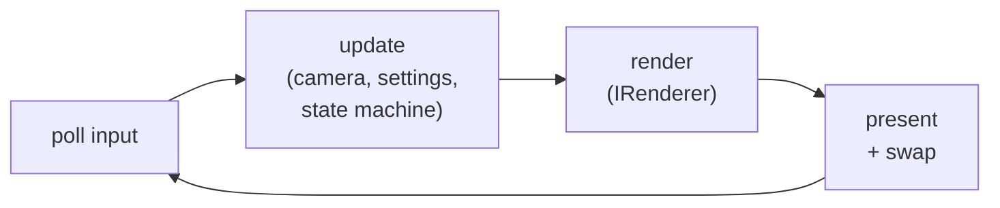
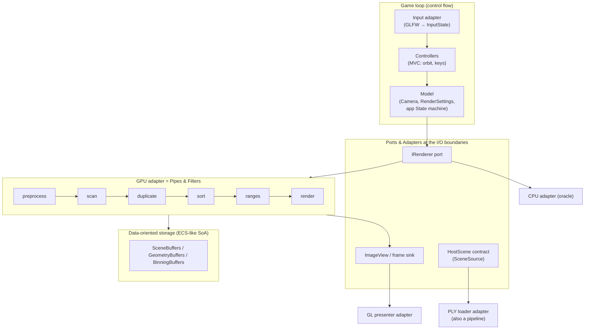

# 04 — Architecture Patterns (and How to Combine Them)

> **Mental model:** *an architecture pattern is a reusable answer to "how should the big pieces be arranged, and which way should dependencies point?". Real systems combine several patterns, each at its own scale:* a layered macro-structure, ports and adapters at the boundaries, a pipeline inside the compute engine, data-oriented storage underneath, and a loop driving it all.

The patterns below are the ones engineers from other teams will recognise on sight. That shared vocabulary is half their value. Saying "the GPU backend is an adapter behind the `IRenderer` port" communicates a whole design in one sentence.

---

## 0. Two principles underneath every pattern

**Dependency direction.** If A `#include`s B or uses B's types, A depends on B, so a change to B can break A. Good architecture makes dependencies point **toward the things that change least**: abstractions, contracts and core maths. Concrete details (CUDA, GL, GLFW, the PLY format) change most, so nothing stable should depend on them.

**Dependency inversion.** When high-level policy ("render this scene from this camera") needs low-level detail ("launch CUDA kernels"), don't let the policy depend on the detail. Make **both** depend on an abstraction owned by the policy side (`IRenderer`), so the arrow points *up* toward the abstraction:

```
 Without inversion                    With inversion
 ┌──────────┐                         ┌──────────┐      ┌────────────────┐
 │ Viewer   │──depends on──▶ CUDA     │ Viewer   │─────▶│ IRenderer      │◀── owned by the
 └──────────┘                         └──────────┘      │ (abstraction)  │    policy side
                                                        └───────▲────────┘
                                                                │ implements
                                                        ┌───────┴────────┐
                                                        │ GpuRenderer    │──▶ CUDA
                                                        └────────────────┘
```

---

## 1. Layered architecture

**Shape:** horizontal layers. Each layer uses only the layers below it.

```
 ┌───────────────────────────────────────────┐
 │ Application    (Viewer, main, controls)   │
 ├───────────────────────────────────────────┤
 │ Services       (renderers, presenter,     │
 │                 loader, camera)           │
 ├───────────────────────────────────────────┤
 │ Platform/infra (CUDA wrappers, GL         │
 │                 wrappers, GLFW window)    │
 ├───────────────────────────────────────────┤
 │ Core           (SPLAT_HD maths, types,    │
 │                 conventions)              │
 └───────────────────────────────────────────┘
       dependencies point ↓ only
```

| | |
|---|---|
| **Solves** | Unstructured "everything includes everything"; lets you understand and replace one layer at a time |
| **Variants** | *Strict* (each layer only uses the one directly below) vs *relaxed* (can use any lower layer; more practical) |
| **Costs** | Pass-through code when a top layer needs something deep; can create a "big ball of layers" with no internal structure |
| **Failure mode** | A lower layer calls up into a higher one (a callback that `#include`s `viewer.h`): a dependency cycle |
| **SplatScope** | The macro-structure: `core/` → `platform/`, `scene/`, `render/` → `app/` |

---

## 2. Ports & Adapters (Hexagonal architecture) and Clean architecture

**Shape:** the application's core logic sits in the middle and talks to the outside world only through **ports** (interfaces it defines). **Adapters** implement the ports for specific technologies. *Clean Architecture* and *Onion Architecture* are close relatives with the same rule: **source-code dependencies point inward**.

```
                     ┌───────────────────────────── adapters (technology) ──────────────────────────┐
                     │                                                                              │
   PLY file ──▶ [ PlyLoader adapter ]                                    [ GpuRenderer adapter ] ──▶ CUDA
                     │                                                                ▲             │
                     ▼                                                                │             │
   GLFW ─────▶ [ GlfwInput adapter ] ──▶ ╔══════════════ CORE ═══════════════╗        │             │
                                         ║  ports (interfaces owned by core):║        │             │
                                         ║   SceneSource   → HostScene       ║────────┤             │
                                         ║   InputSource   → InputState      ║  IRenderer port      │
                                         ║   IRenderer     ← FrameRequest    ║        │             │
                                         ║   FrameSink     ← ImageView       ║        ▼             │
                                         ║  core model: Camera, HostScene,   ║ [ CpuRenderer adapter ]
                                         ║  RenderSettings, conventions      ║                      │
                                         ╚═══════════════════════════════════╝──▶ [ GlPresenter adapter ] ──▶ OpenGL
                     │                                                                              │
                     └──────────────────────────────────────────────────────────────────────────────┘
       "driving" side (things that call in)                         "driven" side (things core calls out to)
```

| | |
|---|---|
| **Solves** | Technology lock-in; untestable logic. The core can be tested with fake adapters (a fake renderer, an in-memory scene source) and no GPU, window or files |
| **Costs** | More interfaces; indirection; it's tempting to create ports nobody needs (YAGNI) |
| **Failure mode** | "Leaky ports": the port's types mention the technology (`IRenderer::render(cudaStream_t)`), so the abstraction is fake |
| **SplatScope** | `IRenderer` (driven port: CPU and GPU adapters), the scene contract `HostScene` (the loader is an adapter), `ImageView` as the frame-sink contract (readback and interop are adapters) |

**Litmus test for a good port:** you can write a 20-line fake adapter for it in a unit test. `IRenderer` passes: a fake renderer that fills the `ImageView` with a gradient tests the whole app loop without CUDA.

---

## 3. Pipes and Filters (pipeline)

**Shape:** a chain of independent processing steps (**filters**) connected by data channels (**pipes**). Each filter knows only its input and output format.

```
 [PLY bytes] ─▶ parse ─▶ activate ─▶ validate ─▶ [HostScene]                (loader pipeline)

 [Scene] ─▶ preprocess ─▶ scan ─▶ duplicate ─▶ sort ─▶ ranges ─▶ render ─▶ [image]   (GPU pipeline)
             N items     N       N → L        L       L        tiles/pixels
```

| | |
|---|---|
| **Solves** | Complex transformations become understandable, testable and replaceable step by step; each pipe is a checkpoint you can inspect |
| **Variants** | *Batch-sequential* (each filter finishes the whole batch before the next starts: SplatScope's kernels) vs *streaming* (items flow through concurrently: Unix pipes, the GPU's hardware graphics pipeline) |
| **Costs** | Intermediate buffers (memory and bandwidth); the per-filter overhead of launch and synchronisation |
| **Trade-off: fusion** | Merging filters (e.g. computing SH inside preprocess instead of a separate pass) saves bandwidth but couples them. **Fuse only when profiling says the intermediate buffer is the bottleneck** |
| **SplatScope** | Inside the GPU backend and the loader. Each pipe has an invariant (module 01 §5), and debug views make the pipes visible |

---

## 4. Data-Oriented Design and Entity-Component-System

**Shape:** separate **data** (plain arrays) from **behaviour** (functions or "systems" that transform whole arrays). Design around how data is *accessed*, not around real-world nouns.

```
 Object-oriented (per-object)                     Data-oriented (per-array)
 class Gaussian {                                 struct GaussianSoA {
   Vec3 mean; Vec3 scale; Quat rot;                 vector<Vec4f> mean_opacity;
   float opacity; float sh[48];                     vector<Vec4f> cov3d_a; …
   virtual void project(const Camera&);             vector<float> sh;      // N × 48
   virtual void draw(Framebuffer&);               };
 };                                               void project_all(const GaussianSoA&, const Camera&, Out&);
 vector<unique_ptr<Gaussian>> scene;              // one tight loop / one kernel over all N

 ✗ pointer chase per object; virtual call per object;     ✓ contiguous, cache/coalescing-friendly;
   cache lines full of fields you don't need;               one call per N; maps 1:1 to a kernel
   can't be uploaded to a GPU as is
```

**ECS** (Entity-Component-System, used by many game engines) generalises this: an *entity* is just an id, *components* are SoA arrays indexed by entity, and *systems* are functions that iterate the entities that have certain components.

| | |
|---|---|
| **Solves** | Performance on modern hardware (CPU caches, GPU coalescing); trivially parallel loops; easy serialisation |
| **Costs** | Less "natural" modelling; invariants spread across arrays (all must stay the same length); harder when entities are very heterogeneous |
| **SplatScope** | The whole Gaussian data model. Gaussians are entities, the scene buffers are components, and kernels are systems. Module 06 goes deep |

---

## 5. The game loop (main loop)

**Shape:** an explicit loop that, every frame, **reads input → updates state → renders → presents**. It's the dominant control-flow pattern for real-time interactive software.



| | |
|---|---|
| **Solves** | Deterministic ordering ("input is applied before this frame renders"); a single place to measure frame time |
| **Variants** | Variable timestep (SplatScope: camera motion scales with frame time) vs fixed timestep (physics simulations) |
| **Costs** | Busy loop uses power (vsync or event-waiting fixes it: `glfwWaitEvents` when nothing changed is a nice laptop-battery optimisation) |
| **Alternative** | Pure event-driven (callbacks do the work), which is common in GUI apps. It makes "what happens in what order within a frame" hard to reason about |

---

## 6. Event-driven / Observer / message bus

**Shape:** components publish events ("window resized", "scene loaded"); other components subscribe. Publishers don't know their subscribers.

```
 Window ──"resized(w,h)"──▶ [ event bus ] ──▶ Presenter.on_resize
                                          ├─▶ Renderer.on_resize
                                          └─▶ Camera.on_resize
```

| | |
|---|---|
| **Solves** | Decoupling: adding a listener doesn't touch the publisher. Good for many independent reactions to one occurrence |
| **Costs** | **Control flow becomes invisible.** "What happens on resize, and in what order?" is now scattered across subscribers. Order dependencies are easy to break (the PBO must be recreated *before* interop re-registers) |
| **Failure mode** | Event cascades, re-entrancy (a handler publishes another event), subscribers that outlive publishers (dangling callbacks: an ownership problem again) |
| **SplatScope decision** | **Don't use a bus.** GLFW callbacks only *record* facts into `InputState` (a flag, the new size). The game loop then handles them **explicitly, in a fixed order**: resize presenter → resize renderer → update intrinsics. That's the observer pattern at the very edge, and explicit control flow everywhere else |

---

## 7. Microkernel / plugin architecture

**Shape:** a small, stable core plus independently built plugins that register capabilities (loaders, renderers, exporters).

| | |
|---|---|
| **Solves** | Extensibility by people who don't change the core; optional dependencies loaded at runtime |
| **Costs** | Stable plugin ABI (C++ ABI is fragile, so plugin interfaces are usually C or carefully versioned); discovery, versioning, packaging |
| **SplatScope** | **Not now** (YAGNI). The *seam* already exists: `HostScene` for loaders and `IRenderer` for backends. Turning them into plugins later is a contained change. Module 11 covers when it's worth it |

---

## 8. Render graph (frame graph)

**Shape:** each frame is described **declaratively** as a graph of passes and the resources they read and write. A compiler then orders the passes, inserts synchronisation, allocates transient resources and **aliases memory** between resources whose lifetimes don't overlap. This idea was popularised by Frostbite's "FrameGraph" talk (GDC 2017) and is used in most modern engines.

```
 declare:  pass "preprocess"  writes geom.*
           pass "duplicate"   reads geom.*        writes keys, vals
           pass "sort"        reads keys, vals    writes keys', vals'
           pass "render"      reads keys', geom.* writes image
 compile:  topological order + barriers + lifetime of each transient
           keys/vals die after "sort" → their memory can be reused by a later transient
```

| | |
|---|---|
| **Solves** | Dozens or hundreds of passes with automatic sync and memory aliasing; passes can be added or removed without manual bookkeeping |
| **Costs** | A framework to build or adopt; indirection makes the actual order less visible; overkill for six fixed passes |
| **SplatScope** | **Learn it, don't build it.** Read the GPU pipeline as a tiny hand-compiled render graph: the lifetime classes in module 03 §10 are exactly what a frame-graph compiler computes automatically |

---

## 9. Model–View–Controller (and relatives)

**Shape:** **Model** (state: scene, camera, settings), **View** (presents it: renderer + presenter), **Controller** (turns input into model changes: `OrbitController`, key bindings). MVP and MVVM vary how the view and the logic talk.

In SplatScope the mapping is light: `OrbitController` and the key-binding table are controllers; `Camera` + `RenderSettings` + `HostScene` are the model; the renderer + presenter are the view. The main value is the **discipline**: controllers never draw, views never change state. That's what makes a keyboard-driven debug UI easy to add, and ImGui easy to swap in later.

---

## 10. Composing patterns: SplatScope's architecture

Patterns operate at different scales. Here is what each one does in SplatScope:



Layering wraps it all: `core/` at the bottom and `app/` at the top, with dependencies pointing down and inward.

---

## 11. Alternatives: four whole-system architectures for SplatScope

| | **A. Classic OOP layers** | **B. Hexagonal + DOD core + pipeline backends** (recommended) | **C. Engine-style: ECS + render graph** | **D. Python front-end + C++/CUDA core** |
|---|---|---|---|---|
| Shape | Class per concept (`Gaussian`, `Scene`, `Renderer`), virtual methods, objects own sub-objects | Layers; ports at the backend and I/O boundaries; SoA data; explicit pipelines | Entities/components for everything; frame graph schedules passes | `pybind11` module exposing the renderer; app logic, UI and tests in Python |
| Learning value | OOP modelling; less about hardware | **Ownership, DOD, GPU pipelines, clean boundaries: exactly your goals** | Engine architecture, at the cost of a lot of framework | Bindings, mixed-language builds; less C++ architecture |
| Performance | Poor at the per-Gaussian level (virtual calls, pointer chasing, can't upload objects) | Good; natural fit for kernels | Good, and best at scale (memory aliasing) | Same kernels; Python overhead only per frame |
| Testability | Medium (needs mocks of concrete classes) | **High:** fake adapters, CPU oracle | High, but the framework must be tested too | High (pytest, NumPy comparisons) |
| Complexity | Low at first; grows badly | Medium | High | Medium (build and packaging complexity) |
| Familiar to others | Very | **Very** (hexagonal + pipeline are standard vocabulary) | To game/engine engineers | To ML engineers (it's how gsplat and the reference rasterizer are used) |
| When to choose | Small apps, non-performance-critical domains | **This project** | A multi-feature renderer with many passes and a team | Integrating with training code or notebooks (module 11) |

**Recommendation: B.** It directly exercises everything you said you want to learn. D is a natural *later* extension: the same C++ core with a Python adapter, which is itself a ports-and-adapters move.

---

## 12. Apply to SplatScope

**Step 1:** draw the hexagon (§2) for SplatScope yourself. List every port with its direction (driving or driven), its contract type, and its adapters (today and planned).

**Step 2:** write **ADR-006: overall architecture.** Option B, with A, C and D as the rejected alternatives and *why*. Include "what would make us revisit this" (for example, >15 passes would favour a render graph).

**Step 3: make the layering real in CMake.** One library target per layer (`splat_core`, `splat_scene`, `splat_render_cpu`, `splat_render_cuda`, `splat_present`, …) with `target_link_libraries` mirroring the allowed dependencies. Then **a forbidden include doesn't link**. That's architecture enforced by the build, not by code review.

**Step 4:** write the **fake adapters** first: `FakeRenderer` (fills a gradient), `InMemorySceneSource` (5 hand-made Gaussians). Get the app loop, state machine and presenter working with them *before* the CUDA backend exists. This is the walking skeleton from module 01 §8.

**Step 5:** generate the dependency graph (`cmake --graphviz`) and compare it with the intended one.

**Checkpoint:**
- `splat_render_cuda` doesn't link against anything GL- or GLFW-related.
- `splat_core` links against nothing.
- The app runs end-to-end with `FakeRenderer` and no CUDA.

---

## 13. The senior lens

- Which way do dependencies point? Toward stability?
- Is every port's contract free of technology-specific types?
- Can I test the core with fakes in milliseconds?
- Is any pattern here for its own sake? (An event bus for three listeners? A plugin system for one loader?)
- Where is control flow explicit, and where did we accept implicit flow? Is that deliberate?
- What would force us to the next architecture up (render graph, plugins, services), and how far away is it?

## 14. Interview probes

| Question | Strong answer |
|---|---|
| Explain hexagonal architecture. | Core logic defines ports (interfaces); technology-specific adapters implement them; dependencies point inward; the core is testable with fakes |
| Layered vs hexagonal? | Layers are a vertical stack; hexagonal is inside vs outside. They compose: hexagonal at the boundaries, layers for the macro-structure |
| What is dependency inversion? | High-level policy and low-level detail both depend on an abstraction owned by the policy side |
| When is an event bus a bad idea? | When ordering matters or there are few listeners: it hides control flow and creates lifetime and re-entrancy problems |
| Why data-oriented design for a renderer? | Access patterns dominate performance; SoA arrays give contiguous, coalesced access, map one-to-one onto kernels, and avoid per-object dispatch |
| What does a render graph buy you? | Automatic pass ordering, synchronisation and transient-memory aliasing from declared reads and writes; worth it at many passes |
| Pipes & filters: when do you fuse stages? | When profiling shows the intermediate buffer's bandwidth or the launch overhead dominates. Fusion trades modularity for speed |
