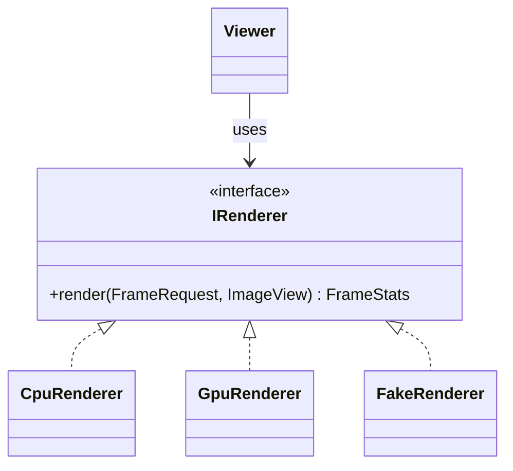

# 05 — Design Patterns & C++ Idioms

> **Mental model:** *architecture patterns (module 04) arrange the big pieces. Design patterns solve recurring problems **inside** a component: how to swap an algorithm, hide an implementation, react to an event, represent a mode. Each pattern is a named trade-off. Use the name when it helps others read your code, and skip the pattern when a plain function would do.*

For each pattern: **the problem → the shape → the C++ spelling → its cost → where it lives in SplatScope → the alternative.**

---

## 0. SOLID in one table (the vocabulary reviewers use)

| Principle | One-line meaning | SplatScope example | Violation today |
|---|---|---|---|
| **S**ingle responsibility | A class has one reason to change | `Presenter` only shows images; `GpuRenderer` only renders | `CpuRenderer`/`GpuRenderer` also own GL presentation (`Display`) |
| **O**pen/closed | Extend behaviour by adding code, not editing existing code | New debug view = new enum value + one kernel branch; new backend = new `IRenderer` implementation | Adding a buffer edits struct, alloc, free and kernel |
| **L**iskov substitution | Any implementation can stand in for its interface | CPU and GPU renderers accept identical inputs and produce comparable `FrameStats` | CPU path broken by the RGBA framebuffer change |
| **I**nterface segregation | Don't force clients to depend on methods they don't use | `IRenderer` has 3 methods; debug features stay off it | — |
| **D**ependency inversion | Depend on abstractions owned by the policy side | `Viewer` depends on `IRenderer`, not CUDA | `viewer.cpp` includes `gpu_renderer.h`, which includes the CUDA pipeline header |

---

## 1. Strategy: swap an algorithm behind a stable interface

**Problem:** several interchangeable algorithms (CPU vs GPU rendering; readback vs interop presentation; 3σ vs opacity-aware radius).



| Spelling | Cost | Use when |
|---|---|---|
| **Runtime: virtual interface** (SplatScope) | One indirect call; heap allocation | Coarse boundaries, runtime switching |
| Compile-time: template parameter / policy | Zero overhead; code bloat; no runtime switching | Hot inner loops (per pixel, per Gaussian) |
| `std::function` / lambda | Small allocation possible; type-erased | One-function strategies (a comparator, a callback) |
| `enum` + `switch` | Zero overhead; closed set; every switch must be updated | Small fixed sets *inside one component* (the `DebugView` branch in the render kernel) |

**Note:** in GPU kernels, a runtime `switch` on a per-frame constant (like the debug view) costs almost nothing, because every thread takes the same branch, so there's no warp divergence (module 07). A per-*thread* varying branch is a different story.

---

## 2. Factory: hide which concrete type gets built

**Problem:** the app must create "a renderer" without depending on the CUDA backend's headers.

```
 app/viewer.cpp                         render/cuda/gpu_renderer.cu
 ─────────────────                      ─────────────────────────────
 #include "render/renderer.h"           class GpuRenderer final : public IRenderer { … };   // full class here
 auto r = make_renderer(cfg);    ──▶    std::unique_ptr<IRenderer> make_gpu_renderer(const Cfg& c)
                                        { return std::make_unique<GpuRenderer>(c); }
```

- **Factory function** (above): the simplest and most common form in modern C++. It returns `unique_ptr<Interface>`, so ownership transfers to the caller.
- **Abstract factory:** an object that creates a *family* of related products (e.g. a backend factory that makes a renderer + a matching interop target). Use it if those families appear.
- **Cost:** callers can only use the interface, so backend-specific features need another route.
- **Alternative:** PIMPL (§4) when you want a *concrete* type with extra methods.

---

## 3. Facade: one simple entry point to a complex subsystem

**Problem:** the GPU pipeline has a stream, 8 kernels, CUB calls and a dozen buffers. The app needs `render()`.

```
            ┌──────────────── GpuRenderer (facade) ────────────────┐
 render() ─▶│ preprocess → scan → readback L → ensure capacity →   │
            │ duplicate → sort → ranges → render → stats           │
            └──────────────────────────────────────────────────────┘
```

A facade is a **deep module** (module 01 §4.3). *Cost:* it can become a god object if every feature is added to it. *Guard:* the facade orchestrates and owns, but each stage is a free function with an args struct ([`gpu-forward-pass/05 §3`](../gpu-forward-pass/05-cpp-implementation-guide.md#3-kernel-interface-args-structs--host-launchers)).

---

## 4. PIMPL (Pointer to IMPLementation): a compilation firewall

**Problem:** a class's private members need heavy or platform-specific headers (CUDA, GL). Every includer would recompile when they change, and would need those headers.

```
 gpu_renderer.h (public, light)          gpu_renderer.cu (private, heavy)
 class GpuRenderer {                     struct GpuRenderer::Impl {
   …public API…                            CudaStream stream; SceneBuffers scene; …
   ~GpuRenderer();  // declared here     };
 private:                                GpuRenderer::~GpuRenderer() = default;  // Impl complete here
   struct Impl;                          
   std::unique_ptr<Impl> impl_;
 };
```

| Pros | Cons |
|---|---|
| Header has no CUDA types; faster rebuilds; stable ABI | One heap allocation and one pointer indirection per call; boilerplate (out-of-line special members) |

**The gotcha:** `unique_ptr<Impl>` needs `Impl` to be complete wherever the destructor is *instantiated*. So declare `~GpuRenderer()` in the header and define it in the `.cu`. **PIMPL vs factory + interface:** both isolate CUDA. The factory is less code; PIMPL keeps a concrete type ([`gpu-forward-pass/05` alternatives](../gpu-forward-pass/05-cpp-implementation-guide.md#alternatives--trade-offs)).

---

## 5. Adapter: make a foreign interface fit yours

**Problem:** an external API (tinyply, GLFW callbacks, a future `.splat` format) doesn't speak your types.

```
 tinyply::PlyData (channel-major f_rest, log-scale, logit opacity, wxyz)
        │  PlyLoader adapter: parse → activate → reorder SH → validate
        ▼
 HostScene (your contract: activated, coefficient-major, wxyz named, finite)
```

An adapter is the *implementation side* of a port (module 04 §2). It converts formats and conventions, and is the **only** place that knows about them. *Cost:* a conversion pass. *Benefit:* quirks never spread.

---

## 6. Observer, kept at the edges

**Problem:** GLFW needs to notify you of input. The pattern is unavoidable at the C-API boundary.

**SplatScope's discipline:** observers (GLFW callbacks) only **record facts** (`pressed this frame`, `new size`, `mouse delta`) into `InputState`. All reactions happen later, in the game loop, in a fixed order. This keeps the benefits (decoupling from GLFW) and avoids the costs (hidden control flow, re-entrancy, callbacks touching GL state mid-poll). See module 04 §6.

**Lifetime hazard:** an observer registered with a raw `this` must unregister, or be guaranteed to outlive, the subject. GLFW's user pointer is exactly this (module 03 §5.3).

---

## 7. Command: actions as data

**Problem:** keyboard shortcuts scattered as `if (key == 'G') … else if (key == 'H') …` are hard to list, rebind or test.

```
 struct Action { const char* name; void (*apply)(AppState&); };
 constexpr KeyBinding kBindings[] = {
     { GLFW_KEY_G, {"toggle backend",   toggle_backend}   },
     { GLFW_KEY_H, {"cycle SH degree",  cycle_sh_degree}  },
     { GLFW_KEY_1, {"view: final",      set_view<DebugView::Final>} }, …
 };
 // per frame: for each key pressed this frame → find binding → apply(state)
```

| Pros | Cons |
|---|---|
| One table lists every shortcut (it prints a help screen for free); actions unit-testable without a window; rebindable; easy to add undo or recording later | Slight indirection |

**Alternative:** a plain `switch` in one function. Fine for 5 keys; the table wins at about 10 or more, or when you want `--help` output.

---

## 8. State: make modes explicit

**Problem:** behaviour depends on mode (Loading, Ready, Minimised, Degraded, Failed; and Interop vs Readback). Scattered boolean flags create impossible combinations (`loading && minimised && degraded`).

Three C++ spellings:

| Spelling | Shape | Pros | Cons |
|---|---|---|---|
| **`enum class` + `switch`** (recommended for app state) | `AppState state; switch(state) …` | Simplest; exhaustive `switch` warnings (`-Wswitch`) | State-specific data lives elsewhere |
| **`std::variant<Loading, Ready, Failed…>` + `std::visit`** | Each state is a struct holding *its own data* (`Failed{std::string reason}`) | Impossible states unrepresentable; the data travels with the state | More verbose |
| Classic GoF State (virtual class per state) | `unique_ptr<IState>` with `on_frame()`, `on_resize()` | Open to new states | Heavy for a handful of states |

The `std::variant` version is worth trying once: "make impossible states unrepresentable" is a widely quoted senior principle, and variants are how C++ expresses it.

---

## 9. Builder and designated initialisers

**Problem:** constructing an object with many fields, some optional, readably and safely.

- In C++20, **designated initialisers on aggregate args structs** cover most cases: `PreprocessArgs{ .mean_opacity = …, .cam = cam, .depth = geom.depth.span() }`. Named fields mean no argument-order bugs (the 18-positional-parameter kernel today).
- A real **Builder** is useful when construction has *steps* and *validation*: `HostSceneBuilder` in the loader accumulates properties, then `build()` validates the invariants (equal lengths, finite values) and returns `shared_ptr<const HostScene>`. After `build()`, the scene is immutable. That's a clean way to turn "mutable while loading" into "immutable forever".

---

## 10. Static polymorphism: Template Method vs policies vs CRTP

**Problem:** share an algorithm skeleton while varying steps, without virtual-call cost in hot code.

| Technique | Shape | Use |
|---|---|---|
| **Template Method** (GoF, dynamic) | Base class runs the skeleton, calls virtual hooks | Coarse-grained frameworks |
| **Non-Virtual Interface (NVI)** | Public non-virtual `render()` does timing, validation and logging, then calls private virtual `do_render()` | **Recommended for `IRenderer`**: every backend gets identical `FrameStats` timing and argument checks for free |
| **Policy-based design** | `template<class StoragePolicy> class SceneBuffers` | Compile-time choice, e.g. `ShStorageF32` vs `ShStorageF16` for SH coefficients |
| **CRTP** (Curiously Recurring Template Pattern) | `class GpuRenderer : RendererBase<GpuRenderer>`; the base calls `static_cast<Derived*>(this)->step()` | Static dispatch with a shared skeleton; mixins (e.g. a `NonCopyable` base) |

**NVI example of value:** with a public non-virtual `render()`, you can assert `view.width == extent.width` once for all backends, instead of trusting every implementation to check.

---

## 11. Type erasure: value semantics with runtime polymorphism

**Problem:** you want runtime polymorphism (like an interface) but value semantics (copyable or movable, no `unique_ptr` at call sites), or to accept unrelated types that share a shape.

```
 std::function<void(AppState&)>    ← type erasure for "any callable"
 std::any                          ← type erasure for "any value"
 class AnyRenderer {               ← hand-written: stores any T with render(); internally a
   struct Concept { virtual … };     virtual Concept + template Model<T>. The interface is
   template<class T> struct Model;   implicit (duck typing) rather than inherited
   std::unique_ptr<Concept> self_;
 };
```

**SplatScope:** you only need `std::function` (for Command actions, if you prefer lambdas to function pointers). Hand-written type erasure is an interview favourite: be able to sketch the Concept/Model structure. Don't build it here.

---

## 12. Null Object and fakes

**Problem:** special-casing "no renderer" or "no scene" with `if (ptr)` checks everywhere.

- **Null Object:** an implementation that does nothing safely. A `NullPresenter` for headless tests discards frames.
- **Fake:** a working but simplified implementation for tests. `FakeRenderer` (gradient), `InMemorySceneSource`.

Both depend on having **ports** (module 04 §2). They're the payoff of designing interfaces at the boundaries.

---

## 13. Strong types: let the compiler catch unit and space mix-ups

**Problem:** `int` widths in pixels vs tiles; `float*` buffers in world vs camera space; `Vec4f` quaternion wxyz vs xyzw. Review findings A4 (tile count vs tile size) and C6 (xyzw vs wxyz) are both type-confusion bugs.

```
 struct Extent2D   { int width, height; };            // pixels
 struct TileExtent { int tiles_x, tiles_y; };          // tiles — not implicitly convertible
 struct QuatWXYZ   { float w, x, y, z; };              // order in the type name
 struct WorldPoint { Vec3f p; };  struct CameraPoint { Vec3f p; };
```

*Cost:* a few lines per type; conversions become explicit functions (`to_tiles(Extent2D)`), which is exactly where you want the logic. Strong types are zero-cost at runtime.

---

## 14. Anti-patterns to recognise (and avoid)

| Anti-pattern | Looks like | Why it hurts | Instead |
|---|---|---|---|
| **Singleton** | `CudaContext::instance()` | Hidden global dependency; destruction order after `main` (a CUDA teardown crash); untestable | Owned object passed explicitly (composition root) |
| **God object** | `Viewer` that loads, renders, handles keys, owns GL | Every change touches it; everything depends on it | Composition root that *wires* small components |
| **Service locator** | `Services::get<IRenderer>()` anywhere | Dependencies are invisible in signatures | Constructor injection |
| **Boolean parameters** | `render(cam, true, false)` | Unreadable call sites | Enums or settings structs |
| **Out-parameters everywhere** | `void project(…, float& out_u, float& out_v)` | Unclear ownership and initialisation | Return a struct |
| **Primitive obsession** | `float*` for every buffer, `int` for every size | Type-confusion bugs (A4, C6) | Strong types, `DeviceSpan<T>` |

---

## 15. Apply to SplatScope

**Step 1:** build a **pattern map**: a table listing each pattern above, whether SplatScope uses it, where (file or class), and why. Patterns you *rejected* go in it too, with the reason.

**Step 2:** implement in this order (each is small):
- **NVI** on `IRenderer`.
- **Factory** functions for the backends.
- **Command** table for keys.
- **`enum class AppState`** + `switch`.
- **Strong types** `Extent2D`, `TileExtent`, `QuatWXYZ`.
- **Builder** for `HostScene` in the loader.
- **Fakes** for testing.

**Step 3:** write the **help screen** (`F1` or `--help`) generated from the Command table. It's a free test that the table is complete.

**Step 4:** code-review your own diff against §14 before every commit.

**Checkpoint:**
- No global mutable state (`grep` for `static` outside `constexpr`).
- The app's key help prints every binding.
- A deliberate pixel/tile mix-up fails to compile.

---

## 16. Interview probes

| Question | Strong answer |
|---|---|
| Strategy vs State? | Same structure, different intent: Strategy is chosen by the client; State changes itself as events happen |
| Why might PIMPL be preferred over an interface? | You keep a concrete type with all its methods, plus value-like construction; the interface only exposes what it declares |
| What's the PIMPL destructor gotcha? | `unique_ptr<Impl>` needs a complete type at destructor instantiation: define the destructor out of line |
| What is NVI, and why use it? | Public non-virtual method wraps a private virtual one, to enforce pre/post-conditions and cross-cutting concerns once |
| How does type erasure work? | A virtual Concept interface + a template Model<T> that wraps any T; the outer class holds `unique_ptr<Concept>` |
| Why avoid singletons? | Hidden dependencies, static destruction-order problems, and they're hard to test or replace |
| CRTP use cases? | Static polymorphism, mixins, compile-time interfaces without vtables |
