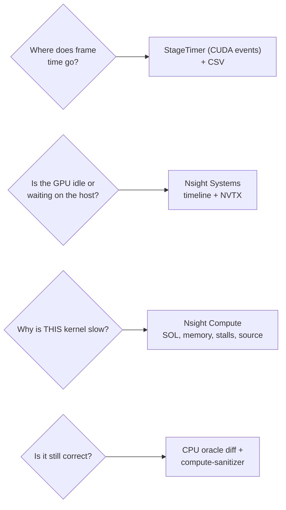

# 08 — GPU Optimisation Methodology

> **Mental model:** *optimisation is the scientific method applied to a time budget. State a target. Find the bottleneck **by measurement**. Change **one** thing, based on a hypothesis that **predicts a number**. Keep the change only if the number moves, and the oracle still agrees.*

---

## 1. The problem: how optimisation goes wrong

| Mistake | Example | Consequence |
|---|---|---|
| Optimising the non-bottleneck | Hand-tuning the scan (1% of the frame) | Weeks for 1% |
| Measuring the wrong thing | `std::chrono` around a kernel launch (measures the *launch*, ~µs) | "It's instant!" (it isn't) |
| Measuring noise | One frame, vsync on, battery power, a laptop warming up | Phantom 20% "improvements" |
| Several changes at once | fp16 SH + new block size + `__expf` in one commit | Can't tell which helped and which hurt |
| No correctness check | A faster kernel that's subtly wrong | Fast garbage |
| Folklore | "Shared memory is always faster" | Slower code with bank conflicts and lower occupancy |

---

## 2. Know your ceiling: Amdahl's law

If a fraction *p* of the frame is sped up by a factor *s*:

$$
\text{speedup} = \frac{1}{(1-p) + p/s}
$$

If render is 40% of the frame, making it *infinitely* fast gives at most $1/(0.6) = 1.67\times$. **Profile the whole frame first.** The stage table from `StageTimer` tells you where *p* is large.

```
 frame (example, measure yours):  ███ pre ██ dup ████ sort █ rng ████████ render ██ present
                                   15%     8%     20%    2%      40%           15%
 → biggest p: render, then sort, then preprocess/present
```

---

## 3. Know your hardware ceiling: the roofline model

Every kernel is limited by either **arithmetic throughput** or **memory bandwidth**. **Arithmetic intensity** $I$ = FLOPs performed per byte moved to or from DRAM.

$$
\text{attainable FLOP/s} = \min\big(\text{peak FLOP/s},\; I \times \text{bandwidth}\big)
$$

GTX 1650 Max-Q (approximate; depends on clocks and memory type): peak FP32 ≈ 2–2.6 TFLOP/s; bandwidth ≈ 128–192 GB/s. That puts the **ridge point** at ≈ 13–20 FLOP/byte.

```
 attainable
 GFLOP/s  ▲
   2500   │                          ┌────────────────────────── compute roof
          │                        ╱ │
          │                      ╱   │
          │                    ╱     │      ● render (reads mostly from shared memory → high DRAM intensity;
          │                  ╱       │        limited by exp/ALU, latency and imbalance)
          │                ╱         │
          │   ● preprocess (SH3: ~1–2 FLOP/B) → memory-bound: speed ∝ bytes read
          │   ● sort, scan, duplicate (~0 FLOP/B) → pure bandwidth
          │ ╱  bandwidth roof (slope = 128–192 GB/s)
          └──────────────┬──────────────────────────────────────▶ arithmetic intensity (FLOP/byte)
                        ~15 (ridge)
```

**How to use it:**

- A **memory-bound** kernel gets faster only by **moving fewer bytes**: smaller types (fp16), fewer passes (sort `end_bit`), skipping culled data, better coalescing.
- A **compute-bound** kernel gets faster by **doing fewer or cheaper operations**: `__expf`, early exits, skipping zero-contribution work.
- A kernel far *below* both roofs is **latency-bound** or **imbalanced**: it needs occupancy, ILP or better load balance.

Nsight Compute's **"Speed of Light"** section tells you the measured % of peak compute and % of peak memory. That's your roofline position, measured.

---

## 4. Measurement discipline

### 4.1 A deterministic benchmark harness

Build this first (it's phase 9 of the [implementation track](09-implementation-track.md)):

```
 splatscope scene.ply --bench camera_path.json --warmup 100 --frames 300 --csv out.csv
   camera_path.json : keyframes (yaw, pitch, distance, target) interpolated over N frames
   out.csv          : frame, N_visible, L, pre_ms, scan_ms, dup_ms, sort_ms, rng_ms, render_ms, present_ms, total_ms
```

A **replayable camera path** is the key idea. Every experiment sees exactly the same views, so differences come from the code, not from where you happened to point the mouse.

### 4.2 Rules

- AC power, performance mode, `glfwSwapInterval(0)`, no other GPU apps.
- Warm up, then report the **median and p95**. Keep the CSV so you can look at the distribution.
- Run A and B **back to back** in the same session (or toggle at runtime). Repeat 3× if the difference is under 5%.
- Time with **CUDA events** on the stream. Annotate with **NVTX** ranges so Nsight Systems labels every stage.
- **Every optimisation runs the oracle comparison afterwards.** Faster but wrong gets reverted.

### 4.3 Tools: which question each one answers



**Nsight Compute sections worth learning first:**

| Section | Tells you | Typical SplatScope finding |
|---|---|---|
| Speed of Light | % of peak SM throughput vs % of peak memory throughput | Preprocess: memory % ≫ compute % |
| Memory Workload Analysis | Bytes per level, **sectors per request**, L1/L2 hit rates | Render gather: many sectors/request; SH reads: L1 hits after first touch |
| Occupancy | Theoretical vs achieved; limiter | Registers limit render at high register counts |
| Warp State Statistics | **Stall reasons**: *long scoreboard* (waiting on global memory), *barrier* (waiting at `__syncthreads`), *math pipe throttle*, … | Render: barrier stalls show imbalance between early- and late-finishing pixels |
| Source counters | Stalls per source line (needs `-lineinfo`) | Which line of the inner loop is hot |

---

## 5. The SplatScope optimisation ladder

Climb it in order. Each rung has a **hypothesis that predicts a number**. Don't start a rung until the previous one is measured and logged.

| Rung | Change | Hypothesis (predicts…) | Metric to watch | Risk |
|---|---|---|---|---|
| **0** | Benchmark harness + oracle check + baseline CSV | — | Baseline median/p95 per stage | — |
| **1** | Remove host-side waste: per-frame `cudaMalloc`/`cudaFree`, `cudaDeviceSynchronize`, pageable copies, kernel `printf` | **p95 drops sharply; gaps vanish from the timeline**; median moves less | nsys gaps; p95 − median | Low |
| **2** | Launch-config sanity: block size 128/256/512 for 1-D kernels; check registers and spills | ±10%; spills → 0 | Achieved occupancy; stall reasons | Low |
| **3** | Preprocess bytes: `float4`+`float2` Σ split; SH loaded only after the cull | Preprocess time ∝ bytes read: predict the % from the bytes saved | DRAM bytes (ncu) vs ms | Low |
| **4** | fp16 storage for SH `f_rest` | Preprocess ≈ −30–45% at SH3 (half of the dominant bytes) | Preprocess ms; oracle max\|Δ\| ≤ 1/255 | Precision |
| **5** | Reduce **L**: opacity-aware radius ([spec](../gpu-forward-pass/04-cuda-forward-pipeline.md#15-dilation-conic-radius)) | Duplicate + sort + render ∝ L: predict from the measured ΔL | L (title bar), those 3 stages | Edge clipping if wrong |
| **6** | Tighter ellipse–tile test in duplicate (both passes!) | Further ΔL for thin ellipses | L; duplicate cost goes *up* slightly | Count/write mismatch: assert it |
| **7** | Sort: `end_bit = 32 + bits(tiles)`, `DoubleBuffer` | ~25% fewer passes; temp memory ↓ | Sort ms; VRAM | Low |
| **8** | Render: naïve → shared-memory batched | Several × on dense tiles | Render ms; barrier stalls | Barrier bugs (racecheck) |
| **9** | Render: `__expf`, minimise per-iteration work | 5–15% of render | Render ms; oracle diff | Accuracy |
| **10** | Render: packed `RenderPacket` gather | Fewer sectors/request in the batch load | ncu sectors/request; render ms | Layout complexity |
| **11** | Render: load balancing (split very heavy tiles; or several pixels per thread) | p95 ↓ on views with hot spots | `GaussiansPerTile` max vs mean; render p95 | Merge-pass correctness ((C, T) associativity) |
| **12** | Present: Phase B interop (on offload) | −2 copies (~0.5 ms at 720p) | nsys memcpy rows | Optimus setup |
| **13** | Launch overhead: CUDA Graphs | Saves µs per launch × ~10 launches. **Hard**, because L changes every frame | Total CPU-side frame time | Complexity vs gain: likely not worth it |

**Order logic:** rungs 1–2 make measurements trustworthy. Rungs 3–7 attack the **memory-bound** stages, using the roofline. Rungs 8–11 attack the **render** stage. Rung 12 depends on the platform. Rung 13 is a lesson in recognising diminishing returns.

---

## 6. The experiment log (keep it in the repo)

`docs/perf/experiments.md`, one row per experiment, **including failures**:

| ID | Date | Commit | Hypothesis | Change | Scene / path | Before (median / p95 ms) | After | Oracle | Kept? | Notes |
|---|---|---|---|---|---|---|---|---|---|---|
| E005 | 2026-11-02 | `abc123` | fp16 `f_rest` halves SH bytes → preprocess −40% | `ShStorage::F16` | truck / orbit.json | pre 4.1 / 4.6 | pre 2.6 / 2.9 | max\|Δ\| 0.8/255 ✅ | ✅ | Total frame −9% (Amdahl: pre was 22%) |
| E006 | … | … | 512-thread preprocess blocks raise occupancy | block 256 → 512 | … | 2.6 / 2.9 | 2.7 / 3.1 | ✅ | ❌ | Occupancy was already ~100%; no effect, as theory predicted |

This log is the *product* of the optimisation work, and some of the best interview material you can have: every claim backed by a number.

---

## 7. Alternatives: optimisation strategies

| Strategy | Pros | Cons | When |
|---|---|---|---|
| **Top-down, measured ladder** (chosen) | Each step justified; reversible; teaches the method | Slower to reach the "max" | Always first |
| Rewrite as one fused "mega-kernel" | Minimum memory traffic and launches | Unreadable; impossible to debug or inspect stage by stage | Production after the design has settled, rarely for learning |
| Port to a library (gsplat kernels) | Instant speed | No learning; integration cost | Shipping products |
| Lower quality (fewer SH degrees, lower resolution, LOD) | Large, predictable wins | Visual change | Production *quality knobs* (module 11) |

---

## 8. Apply to SplatScope

**Step 1:** implement `StageTimer` (events) + NVTX ranges + the `--bench` harness + CSV output.

**Step 2:** record a baseline on two scenes (one small, one large) with two camera paths (an orbit, and a slow zoom into dense geometry, which stresses L).

**Step 3:** draw *your* roofline: plot each stage, using ncu's measured FLOPs and bytes.

**Step 4:** climb rungs 1 → 13, logging every experiment.

**Step 5:** write a one-page **performance report**: where the time goes, which experiments worked, and which didn't and *why*, in roofline and Amdahl terms.

**Checkpoint:**
- Every kept optimisation has a log row with before/after and an oracle check.
- The final report predicts, within ±20%, what happens to frame time if the render stage gets 2× faster (Amdahl).

---

## 9. The senior lens

- What's the target, in milliseconds, for which scene, camera and machine?
- What's *p* for the stage I'm about to optimise? What's the best case by Amdahl?
- Memory-bound, compute-bound, or latency-bound? How do I know?
- What number does my hypothesis predict? What result would refute it?
- Is the oracle still happy?
- Is this optimisation worth its complexity cost, and is it behind a flag so it can be compared?

## 10. Interview probes

| Question | Strong answer |
|---|---|
| How do you optimise a slow GPU program? | Target → whole-frame profile (nsys) → biggest stage → ncu: memory, compute or latency bound → one change with a predicted effect → re-measure → correctness check |
| Explain the roofline model. | Attainable performance = min(peak compute, intensity × bandwidth); it tells you whether to reduce bytes or operations |
| What is Amdahl's law? | Overall speedup is limited by the fraction you don't speed up |
| Why is `std::chrono` around a kernel launch wrong? | Launches are asynchronous; you time the enqueue. Use events, or sync (which changes the behaviour) |
| What does "long scoreboard" stall mean? | Warps are waiting on global or local memory results: you're memory-latency-bound |
| When is shared memory not worth it? | When data isn't reused across threads, or bank conflicts or occupancy loss outweigh the reuse |
| How do you avoid fooling yourself in benchmarks? | Deterministic workload, warm-up, medians and tails, back-to-back A/B, controlled power and thermals, correctness checks |
