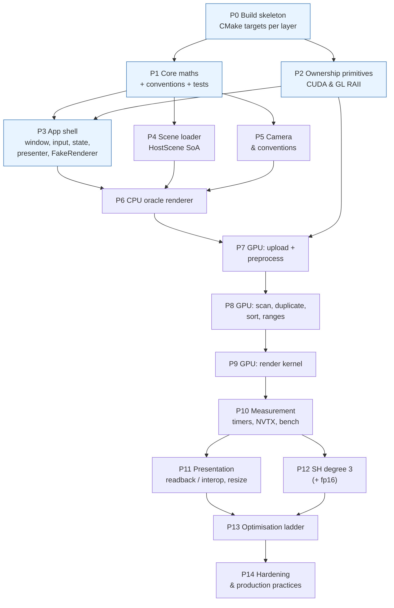

# 09 — The Step-by-Step Implementation Track

> **Mental model:** *build a walking skeleton first, then deepen one vertical slice at a time. Every phase ends with a check a machine can verify, and every phase starts with a diagram.*

This module turns modules 01–08 into an ordered build plan. Each phase lists the modules it relies on, what to **draw** before coding, the ordered **build** steps, a **checkpoint**, and the usual **pitfalls**. The exact specifications (kernel maths, buffer tables, class signatures) live in [`docs/gpu-forward-pass/`](../gpu-forward-pass/README.md) and are linked rather than repeated.

---

## 0. The phase map



The four blue phases form the **walking skeleton**: a window that shows a fake renderer's gradient through the real architecture. Everything after that deepens one slice.

| Phase | Maps to milestone in [`gpu-forward-pass/06`](../gpu-forward-pass/06-roadmap-testing-profiling.md#1-milestones) | Core modules |
|---|---|---|
| P0–P3 | M0 | 02, 03, 04, 05, 10 |
| P4–P6 | M1 | 03, 06 |
| P7 | M2 | 07 |
| P8 | M3 | 04 §3, 07 |
| P9 | M4 | 07 |
| P10–P11 | M5 | 03 §9, 08 |
| P12 | M6 | 06, gpu-forward-pass 04 §1.7 |
| P13 | M7 | 08 |
| P14 | — | 10, 11 |

**Working agreements for every phase:**

- One branch and one PR per phase (or per half-phase if it's big).
- Each PR updates the diagrams it affects, and adds an ADR if it makes a decision.
- CI must be green: CPU-only build + tests in CI; GPU tests run locally (module 10).
- Each phase's checkpoint is **written as a test or a script** whenever possible.

---

## P0 — Build skeleton

**Learn:** module 04 §12 (layers as CMake targets), module 10 §5 (tooling).
**Draw first:** the C4 component diagram (module 02 §3.3) as the *intended* target graph.

**Build:**
1. Restructure `src/` into the layer directories ([`gpu-forward-pass/02 §1`](../gpu-forward-pass/02-architecture.md#1-layers-and-dependency-direction)).
2. One CMake library target per layer; `target_link_libraries` mirrors the allowed arrows; CUDA enabled only under `SPLATSCOPE_WITH_CUDA` ([target table](../gpu-forward-pass/05-cpp-implementation-guide.md#8-cmake-structure-target-graph-not-the-full-file)).
3. `FetchContent` for tinyply and the test framework, at pinned tags. Lower `cmake_minimum_required` to 3.24.
4. `CMakePresets.json`: `debug`, `release`, `relwithdebinfo`, `cpu-only`, `asan`, with `CMAKE_CUDA_ARCHITECTURES=75` and your `CMAKE_CUDA_HOST_COMPILER`.
5. `.clang-format` (commit it; it's currently gitignored), `.clang-tidy`, warnings-as-errors in CI.
6. Empty `tests/` target with one passing test.

**Checkpoint:**
- `cmake --preset cpu-only && cmake --build --preset cpu-only && ctest` passes on a fresh clone.
- `cmake --graphviz` output matches your intended graph.

**Pitfalls:** glm or tinyply still required from `external/`; CUDA flags leaking into host targets; forgetting that `.gitignore` excludes `.clang-format`.

---

## P1 — Core maths, conventions, unit tests

**Learn:** module 01 §5 (invariants), module 06, [`gpu-forward-pass/05 §4`](../gpu-forward-pass/05-cpp-implementation-guide.md#4-shared-math-for-host-and-device).
**Draw first:** the coordinate-frames table + a sketch of world/camera/image/tile axes ([`gpu-forward-pass/02 §6`](../gpu-forward-pass/02-architecture.md#6-coordinate-conventions-single-source-of-truth)).

**Build:**
1. `core/hd.h` (`SPLAT_HD`), `core/math.h` (POD vectors, `Sym2`, `Sym3`, `Mat23`, strong types `Extent2D`, `TileExtent`, `QuatWXYZ`).
2. `core/projection.h`: `cov3d_from_scale_rot`, `world_to_camera`, `project_mean`, `projection_jacobian` (with the 1.3·tan clamp), `project_cov`, `conic_and_radius`.
3. `core/tile_rect.h`: `get_tile_rect`, `tile_count`.
4. `core/compositing.h`: `gaussian_alpha`; later `eval_sh`.
5. Analytic unit tests ([`gpu-forward-pass/06 §2.2`](../gpu-forward-pass/06-roadmap-testing-profiling.md#22-analytic-unit-tests-fast-host-only-exact-answers)), including the off-axis finite-difference Jacobian test (the regression test for the transposed J bug).

**Checkpoint:** all analytic tests pass; `splat_core` links against nothing.

**Pitfalls:** using `std::` functions that don't exist in device code; hidden doubles (`1.0`); row-major vs column-major ambiguity (state it in the type comment).

---

## P2 — Ownership primitives

**Learn:** module 03 (all of it), module 05 §4.
**Draw first:** the ownership tree and lifetime bars (module 02 §3.5).

**Build:**
1. `CudaError` + `CUDA_CHECK` / `CUDA_CHECK_LAST` / `SPLAT_DEBUG_SYNC`.
2. `DeviceBuffer<T>`, `DeviceSpan<T>`, `PinnedBuffer<T>`, `CudaStream`, `CudaEvent`.
3. `GlHandle<Policy>` + `GlTexture`, `GlBuffer`, `GlVertexArray`, `GlProgram`.
4. `static_assert` tests for copy/move traits (module 03 §13 step 5); a runtime test that moving a `DeviceBuffer` leaves the source empty and the target valid; a test that `ensure_capacity_discard` grows geometrically and never shrinks.

**Checkpoint:**
- Traits tests compile.
- `compute-sanitizer --leak-check full` on the wrapper tests reports no leaks.
- `grep -rn "cudaFree\|glDelete" src/` matches **only** destructors.

**Pitfalls:** non-`noexcept` moves; forgetting self-move-assignment; a moved-from object that frees on destruction.

---

## P3 — App shell: the walking skeleton

**Learn:** module 04 §2, §5, §6, §9; module 05 §2, §7, §8, §12.
**Draw first:** the app state machine (module 02 §3.7); the per-frame sequence with `FakeRenderer`.

**Build:**
1. `GlfwRuntime`; `Window` (non-copyable, non-movable; framebuffer size; edge-triggered key set cleared each frame).
2. `Presenter`: immutable texture storage (`glTexStorage2D`), `glTexSubImage2D` per frame, no mipmaps, `CLAMP_TO_EDGE`, **the one v-flip**.
3. `IRenderer` with NVI (`render()` → `do_render()`), `FrameRequest`, `ImageView`, `FrameStats`, `RenderSettings`.
4. `FakeRenderer` (draws a gradient plus a moving marker driven by the camera yaw).
5. `Viewer` as the composition root, with members in the commented order ([`gpu-forward-pass/02 §4`](../gpu-forward-pass/02-architecture.md#4-construction-and-destruction-order)); `enum class AppState`; the Command table for keys; `F1` help printout.
6. `main`: parse arguments, catch exceptions at the root, print, return non-zero.

**Checkpoint:**
- The window shows the gradient; orbiting moves the marker.
- `F1` lists all bindings; resize works; minimise doesn't crash.
- Closing the window gives an ASan-clean exit.

**Pitfalls:** GL calls before the context is current; doing work inside GLFW callbacks; window size vs framebuffer size.

---

## P4 — Scene: HostScene and the PLY loader

**Learn:** module 06; module 03 §7 (`shared_ptr<const>`); module 05 §5, §9 (Adapter, Builder); [`gpu-forward-pass/07 §4`](../gpu-forward-pass/07-platform-and-resolved-decisions.md#4-scene-formats-one-loader-now-one-contract-forever).
**Draw first:** the loader as a pipeline (parse → activate → reorder SH → compact → validate) with data shapes on the arrows.

**Build:**
1. `HostScene` (SoA in GPU layout, raw SH coefficient-major, `sh_degree`, `SceneInfo`, `validate()`).
2. `HostSceneBuilder` → `build()` returns `shared_ptr<const HostScene>`.
3. `load_3dgs_ply(path)`: streaming read; header checks with a clear error listing missing properties; degree from the `f_rest_*` count; convert each property group and release its buffer; in-place stable compaction of invalid Gaussians.
4. Tests on tiny hand-written PLYs (ASCII PLY is easiest to write by hand): 1 Gaussian with known values; the SH reorder check; a missing property → error; a NaN row → skipped; degrees 0/1/2/3.

**Checkpoint:**
- Loading a large official scene prints `SceneInfo`.
- Peak RSS < 2× the file size (`/usr/bin/time -v`).
- All loader tests pass under ASan.

**Pitfalls:** the channel-major `f_rest` order; baking `+0.5` into the DC term; Eigen's xyzw quaternion memory order.

---

## P5 — Camera and conventions

**Learn:** module 01 §5; [`gpu-forward-pass/02 §6`](../gpu-forward-pass/02-architecture.md#6-coordinate-conventions-single-source-of-truth).
**Draw first:** the camera frame relative to world for yaw = pitch = 0, with the axes labelled.

**Build:**
1. `Camera` (orbit parameters + intrinsics) → `CameraParams` POD (R, t, fx, fy, cx, cy, size, tan half-FOVs, position).
2. A proper OpenCV-convention rotation (rows: right, down, forward); `world_up` configurable (the `U` key).
3. `OrbitController` (level-triggered mouse); `R` frames the scene AABB.
4. Tests: det(R) = +1 over random parameters; a point straight ahead projects to (cx, cy); a point to the right projects to u > cx; a point below (+y down) projects to v > cy.

**Checkpoint:** all convention tests pass.

**Pitfall:** "fixing" an upside-down image with a second flip instead of finding the first.

---

## P6 — CPU oracle renderer

**Learn:** module 04 §3 (pipes and filters), module 06, [`gpu-forward-pass/04`](../gpu-forward-pass/04-cuda-forward-pipeline.md) (it's the same model).
**Draw first:** the oracle's stages with the same buffer names as the GPU's `GeometryBuffers`, so the comparison points are obvious.

**Build:**
1. Preprocess over arrays using the `core/` functions → SoA outputs shaped like the GPU's.
2. Sort visible Gaussians by depth (front-to-back).
3. Per pixel: front-to-back compositing in a **float** buffer with T, α thresholds, early termination and background. Convert to RGBA8 once, with rounding.
4. Debug views `Centers` and `Ellipses` on the CPU as well.
5. Optional: OpenMP over image rows (disjoint writes, so no false sharing).

**Checkpoint:** a small real scene renders recognisably from all angles: no square clipping, no darkening. Golden images saved for 10 poses (this oracle's output becomes the reference).

**Pitfalls:** different regularisation or near-plane constants from the GPU's: use the single `RenderSettings`.

---

## P7 — GPU I: upload and preprocess

**Learn:** module 07 §2–§6; [`gpu-forward-pass/04 §0–§1`](../gpu-forward-pass/04-cuda-forward-pipeline.md#1-preprocess-one-thread-per-gaussian); [`gpu-forward-pass/03`](../gpu-forward-pass/03-memory-and-data-movement.md).
**Draw first:** the `GpuRenderer::Impl` ownership tree; a data-flow diagram from `HostScene` to `GeometryBuffers`.

**Build:**
1. `GpuRenderer` facade (PIMPL or factory); `Impl` with the buffers grouped by lifetime.
2. `upload()`: copy SoA; temporary scale/quat buffers → `build_cov3d` kernel → free the temporaries (scope-bound).
3. `launch_preprocess` with `PreprocessArgs` (designated initialisers); writes every slot; the A2/A5–A9 fixes are built in.
4. Debug-only download of `GeometryBuffers` for comparison with the CPU arrays.
5. Startup device report (module 07 §13 step 1).

**Checkpoint:**
- Per-Gaussian outputs match the CPU for every Gaussian at 10 poses (floats rtol 1e-4, integers exact).
- `compute-sanitizer --tool initcheck` and `memcheck` are clean.
- The `Centers` and `Ellipses` views match the CPU's visually.

**Pitfalls:** launching with N = 0; reading the quaternion in the wrong order; forgetting `CUDA_CHECK_LAST()`.

---

## P8 — GPU II: scan, duplicate, sort, ranges

**Learn:** module 04 §3; [`gpu-forward-pass/04 §2–§5`](../gpu-forward-pass/04-cuda-forward-pipeline.md#2-scan-tiles_touched--offsets).
**Draw first:** the key layout, and the scan → slots example, on paper with 4 Gaussians.

**(Optional, recommended) P8a, the naïve vertical slice:** sort visible Gaussians by depth with CUB, then a render kernel where each pixel loops over *all* of them. You get a full GPU image quickly, plus a second oracle ([`gpu-forward-pass/06 alternatives`](../gpu-forward-pass/06-roadmap-testing-profiling.md#alternatives--trade-offs)). Use a small or subsampled scene.

**Build:**
1. CUB inclusive scan; pinned L readback on the stream; `BinningBuffers::ensure_capacity_discard(L)` + sort temp re-query.
2. `duplicate_with_keys` using the **shared** `get_tile_rect`; `__float_as_uint(depth)`; debug `assert(off == offsets[idx])`.
3. CUB `SortPairs` with `DoubleBuffer` and `end_bit`.
4. `memsetAsync(ranges)` + `identify_tile_ranges`.
5. Debug-build host checks: keys sorted; ranges partition [0, L); depth non-decreasing within each tile. `GaussiansPerTile` heatmap view.

**Checkpoint:**
- GPU L == CPU-computed L exactly.
- All host checks pass on 10 poses.
- nsys shows no `cudaMalloc`/`cudaFree` in steady state.

**Pitfalls:** stale `tiles_touched`; reading the sort result from the wrong `DoubleBuffer` side; integer overflow if L is huge (use 32-bit unsigned and the L cap).

---

## P9 — GPU III: render kernel

**Learn:** module 07 §5, §7, §8; [`gpu-forward-pass/04 §6`](../gpu-forward-pass/04-cuda-forward-pipeline.md#6-render-one-block-per-tile-one-thread-per-pixel).
**Draw first:** one tile's block, with warps, the shared-memory batch, and the barrier positions marked.

**Build:**
1. Naïve per-tile kernel (each thread reads its range from global memory). Make it correct first.
2. Shared-memory batched version behind a flag; `__syncthreads_count` early exit; no early `return` for out-of-image threads.
3. Remaining debug views: `ContribCount`, `Depth`, `Alpha`, `CpuGpuDiff`.

**Checkpoint:**
- GPU vs CPU: PSNR ≥ 45 dB and max |Δ| ≤ 2/255 on all golden poses.
- `racecheck` and `synccheck` are clean.
- Correct at 801×601 and 1×1.

**Pitfalls:** missing the top-of-loop barrier (a shared-memory race); truncating instead of rounding the output.

---

## P10 — Measurement

**Learn:** module 08 §4.
**Draw first:** the per-frame timeline (module 02 §3.10) with your predicted stage durations.

**Build:** `StageTimer` (event pairs), NVTX ranges, `FrameStats` in the window title, `T` to dump stats, `--bench path.json --frames --csv`, scripted camera paths, `V` to toggle vsync.

**Checkpoint:** a baseline CSV for 2 scenes × 2 paths is committed in `docs/perf/`; the experiment log starts.

---

## P11 — Presentation: readback, interop, resize

**Learn:** module 03 §9 (async lifetime, leases); [`gpu-forward-pass/03 §5–§7`](../gpu-forward-pass/03-memory-and-data-movement.md#7-cudaopengl-interop-phase-b); [`gpu-forward-pass/07 §1.2`](../gpu-forward-pass/07-platform-and-resolved-decisions.md#12-hybrid-graphics-optimus-who-owns-the-screen).
**Draw first:** the presentation-path state machine (module 02 §3.7); the deployment diagram (module 02 §3.11).

**Build:**
1. Phase A with a pinned staging image and a stream sync before upload.
2. Device probe → interop if available: `CudaGlPbo` (registration) + `MappedPbo` (`[[nodiscard]]` lease).
3. Resize: re-create the image-class buffers, PBO, texture and registration, in the right order; keep the FOV when updating intrinsics.

**Checkpoint:**
- Works with and without PRIME offload, and logs which path was chosen and why.
- nsys shows no image memcpys with interop.
- Resizing 50 times in a row leaks nothing.

---

## P12 — SH degree 3 (and fp16)

**Learn:** [`gpu-forward-pass/04 §1.7`](../gpu-forward-pass/04-cuda-forward-pipeline.md#17-colour-spherical-harmonics-degree-03), [`07 §3`](../gpu-forward-pass/07-platform-and-resolved-decisions.md#3-memory-budget-on-a-4-gb-gpu); module 06; module 05 §10 (policy for storage type).
**Draw first:** the SH memory layout of one Gaussian (coefficient-major, 16 × RGB).

**Build:**
1. `SPLAT_HD eval_sh(degree, dir, coeffs)` + constants + unit tests (degree 0 equals the DC formula; known directions).
2. Evaluate it in preprocess only after the cull; `H` cycles the degree.
3. The L cap from `cudaMemGetInfo`.
4. `ShStorage::F16` option behind one access function.

**Checkpoint:**
- GPU rgb vs CPU within 1e-5 at degrees 0–3.
- fp16 max |Δ| ≤ 1/255.
- A large scene loads, or fails with a clear "doesn't fit" message.

---

## P13 — Optimisation ladder

**Learn:** module 08 §5.

**Build:** climb rungs 1 → 13, one experiment per PR, each logged.

**Checkpoint:** the performance report (module 08 §8 step 5).

---

## P14 — Hardening and production practices

**Learn:** modules 10 and 11.

**Build:**
- Loader fuzzing.
- `Degraded` and `Failed` states exercised by tests.
- `install()` rules and a release build.
- CI badge.
- `CONTRIBUTING.md`.
- The design-review document (module 12).

**Checkpoint:** module 12's capstone rubric.

---

## Definition-of-done template (paste into every PR description)

```
Phase / experiment: Pxx — <title>
Diagrams updated: [ ] component  [ ] ownership  [ ] sequence  [ ] state  [ ] n/a
ADR added/updated: ADR-___ or n/a
Tests: [ ] unit  [ ] stage (CPU vs GPU)  [ ] golden  [ ] sanitizer run: ______
Checkpoint (from module 09): ________________________________  ✅ / ❌
Measurements (if perf-relevant): before ____ / after ____ (median/p95, scene, path)
Ownership review (module 03 §14): [ ] done
```
