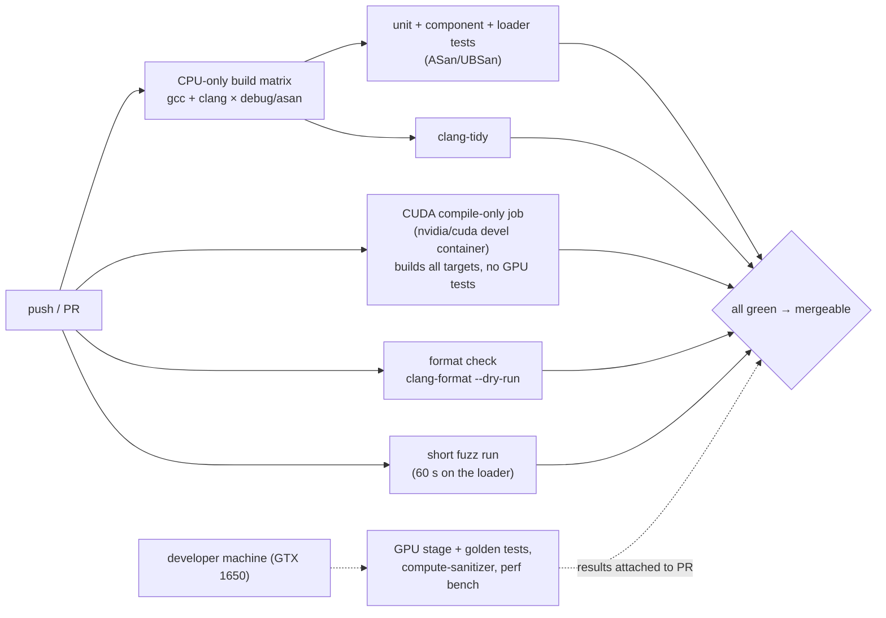

# 10 — Testing & Engineering Practices

> **Mental model:** *tests are your invariants and oracles in executable form. Tooling (compiler warnings, sanitizers, formatters, CI) makes the cheap mistakes impossible, so human review can focus on design and ownership.*

---

## 1. The problem: "it works on my machine, today"

Without automated checks, every change is a gamble: the CPU path silently broke when the framebuffer became RGBA (review E5), and nobody noticed because nothing ran it. Without CI, the repo doesn't even build from a fresh clone (review F1). Engineering practice is what turns a project that works once into one that *keeps* working as it changes.

---

## 2. What to test: the pyramid, adapted to a renderer

```
                     ┌──────────────────────────┐
                     │ manual / exploratory     │  debug views, orbit around, hotkeys
                     ├──────────────────────────┤
                   ┌─┤ golden image tests       │  CPU vs GPU and vs saved references; few, slow
                   │ ├──────────────────────────┤
                   │ │ stage tests (CPU vs GPU) │  per-buffer comparisons after each pipeline stage
                 ┌─┤ ├──────────────────────────┤
                 │ │ │ component tests (fakes)  │  app loop with FakeRenderer; loader on tiny PLYs
               ┌─┤ │ ├──────────────────────────┤
               │ │ │ │ unit tests (core maths)  │  analytic answers; fast; thousands of cases
               └─┴─┴─┴──────────────────────────┘
     more of these ◀───                             ───▶ fewer, slower, more realistic
     + sanitizers and fuzzing run *across* the layers
```

---

## 3. Oracles: how do you know the answer is right?

The hardest part of testing a renderer is knowing what the correct output is. There are five kinds of oracle; use several.

| Oracle | How | SplatScope example |
|---|---|---|
| **Analytic** | Closed-form expected value | Isotropic Gaussian on-axis → $\Sigma_{2D} = (f\sigma/z)^2 I + 0.3I$ |
| **Reference implementation** | A different implementation of the same spec | CPU oracle; the naïve GPU slice; the official Python renderer (once) |
| **Golden / snapshot** | A saved output that was checked by hand once | `tests/golden/*.png` with a tolerance |
| **Property / invariant** | Something that must hold for *any* input | conic · Σ₂D ≈ I; tile ranges partition [0, L); $0 \le T \le 1$; all pixels finite |
| **Metamorphic** | A transformation of the input with a *known* effect on the output | See below |

**Metamorphic testing** is especially powerful for renderers, because it needs no reference image at all:

| Transformation | Expected effect |
|---|---|
| Rotate the scene *and* the camera by the same rigid transform | Identical image at SH degree 0 (higher degrees would also need the SH coefficients rotated, since they live in world space) |
| Scale the scene by k (means ×k, Σ ×k²), and the camera distance by k | Identical image, provided no Gaussian crosses the fixed near plane (view directions for SH are unchanged) |
| Permute the order of Gaussians in the file | Identical image (except exact depth ties) |
| Add a Gaussian behind the camera | Identical image |
| Set one Gaussian's opacity to 0 | Identical to removing it |
| Mirror the scene in world x (means, and Σ via $M\Sigma M$ with $M = \mathrm{diag}(-1,1,1)$) with the camera on the mirror plane looking along it | Horizontally mirrored image, at SH degree 0 |

Each row is a 10-line test that catches whole classes of bugs. The first one would have caught the reflected view matrix.

**Property-based testing:** generate thousands of random valid Gaussians and cameras, and check the property-oracle rows on each. When one fails, *shrink* to the smallest failing case. Frameworks exist (RapidCheck), or a seeded random loop with the seed printed on failure works fine.

---

## 4. Test doubles: the vocabulary

| Double | What it is | SplatScope |
|---|---|---|
| **Dummy** | Passed but never used | An empty `RenderSettings` in tests that don't render |
| **Stub** | Returns canned answers | A `SceneSource` returning a fixed 5-Gaussian scene |
| **Fake** | Working, simplified implementation | `FakeRenderer` (gradient); `InMemorySceneSource` |
| **Spy** | Records how it was called | A presenter that counts frames and stores the last `ImageView` size |
| **Mock** | Pre-programmed expectations about calls | Rarely needed here; prefer fakes and spies (less brittle) |

Doubles need **ports** (module 04 §2). Hard-to-test code is usually code that's missing a port.

---

## 5. Tooling that removes whole bug classes

| Tool | Catches | Run |
|---|---|---|
| Warnings `-Wall -Wextra -Wpedantic -Wshadow -Wconversion` (+ `-Werror` in CI) | Narrowing, shadowing, missing `switch` cases | Every build |
| **AddressSanitizer + UBSan** (`-fsanitize=address,undefined`) | Host use-after-free, overflows, leaks (LSan), UB | `asan` preset, CI |
| **compute-sanitizer** `memcheck` / `racecheck` / `initcheck` / `synccheck` | Device OOB, shared-memory races, uninitialised reads, barrier misuse | Local GPU, per phase |
| **clang-tidy** (`bugprone-*`, `cppcoreguidelines-*`, `modernize-*`, `performance-*`, `readability-*` selectively) | Ownership smells (`cppcoreguidelines-owning-memory`), dangling, needless copies | CI + editor |
| **clang-format** | Style arguments in code review | Pre-commit hook + CI check |
| **Fuzzing** (libFuzzer: `-fsanitize=fuzzer,address`) | Crashes on malformed input | The PLY loader: hostile files must never crash the program (module 11) |
| ThreadSanitizer | Data races between CPU threads | If you add threads (OpenMP oracle, loader thread) |
| include-what-you-use | Accidental transitive includes that hide dependency violations | Occasionally |

---

## 6. Continuous integration

GitHub-hosted runners don't have NVIDIA GPUs. That's fine: **nvcc can compile CUDA code without a GPU**, so CI can still check that every `.cu` file builds.



**GPU test policy:**
- GPU tests detect "no CUDA device" and **skip** (not fail) in CI.
- The PR template asks for the local GPU test + sanitizer result.
- Production teams use self-hosted GPU runners. That's an option for later (module 11).

---

## 7. Version control workflow

| Practice | Why |
|---|---|
| **Short-lived branches, small PRs** (one phase or experiment each) | Reviewable in under 30 minutes; easy to revert; bisectable |
| Conventional commit messages (`feat(render): …`, `fix(loader): …`, `perf(sort): …`, `docs(adr): …`) | Readable history; changelogs can be generated |
| A commit body that explains *why* (the *what* is in the diff) | Future you will need the reasoning |
| No mixing refactor and behaviour change in one commit | Each can be reviewed and reverted separately |
| `git bisect` + a deterministic test | Finds the commit that broke something in log₂(n) steps; this is why small commits matter |

**Branching models compared:**

| Model | Pros | Cons | Fit |
|---|---|---|---|
| **Trunk-based** (short branches → `main` daily-ish) | Simple; continuous integration in the literal sense | Needs good CI and feature flags | ✅ Solo or small team (this project) |
| GitFlow (develop/release/hotfix branches) | Structured releases | Heavy; long-lived branches diverge | Products with scheduled releases and support branches |
| Long-lived feature branches (today's `gpu_renderer`) | Isolation | Painful merges; integrates late | Avoid. Merge the skeleton early and iterate behind flags |

---

## 8. Code review: what seniors look at, in order

1. **Correctness and invariants:** does it do the right thing? What can break? Are the invariants enforced?
2. **Ownership and lifetimes:** module 03 §14 checklist. (In C++, most serious bugs show up here.)
3. **Design:** does it fit the architecture (dependency direction, ports, layers)? Is it the simplest thing that works?
4. **Tests:** do they test behaviour (not implementation)? Is there an oracle? Would they catch a regression?
5. **Performance:** only if it's on a hot path. Is there a measurement?
6. **Readability:** names, comments that explain *why*, consistent with the surrounding code.
7. **Style:** should be automated (clang-format), not discussed.

**Giving review:** ask questions ("what happens if L is 0 here?"), separate blocking from optional ("nit:"), explain the *why*. **Receiving review:** the reviewer is reviewing the code, not you; every comment gets either a fix or a reasoned reply.

Even solo: **review your own PR diff on GitHub the next day.** You'll catch things you didn't see while writing.

---

## 9. Documentation set

| Document | Audience | Content |
|---|---|---|
| `README.md` | Everyone | What, why, build in 3 commands, screenshot, controls |
| `docs/adr/` | Future maintainers | Every significant decision (module 01 §7.2) |
| `docs/architecture/` | Contributors | The diagram set (module 02) |
| `CONTRIBUTING.md` | Contributors | Build presets, tests, sanitizers, PR checklist, commit style |
| `docs/perf/` | Performance work | Baselines, experiment log, report |
| Code comments | Readers of that code | *Why*, invariants, units and conventions, not *what* |
| `CHANGELOG.md` | Users | User-visible changes per version (semantic versioning: MAJOR.MINOR.PATCH) |

---

## 10. Alternatives

| Decision | Options | Notes |
|---|---|---|
| Test framework | GoogleTest / doctest / Catch2 | See [`gpu-forward-pass/05` alternatives](../gpu-forward-pass/05-cpp-implementation-guide.md#alternatives--trade-offs) |
| CI | **GitHub Actions** / GitLab CI / Jenkins / Buildkite | Actions sits next to the repo; Buildkite and Jenkins are common with self-hosted GPU agents |
| Image comparison | Max \|Δ\| + PSNR / SSIM / perceptual metrics (FLIP) | PSNR + max \|Δ\| are simple and enough here; NVIDIA's FLIP gives perceptually meaningful diffs if you want to go further |
| Golden storage | In git (small PNGs) / Git LFS / generated at test time from the oracle | Small PNGs in git are fine at 10 images; generate from the oracle when they'd churn |
| Fuzzer | libFuzzer / AFL++ | libFuzzer integrates with CMake and clang easily |

---

## 11. Apply to SplatScope

1. Add `.clang-format`, `.clang-tidy`, `CMakePresets.json` and a pre-commit hook.
2. GitHub Actions workflow: format → CPU matrix (gcc/clang × debug/asan) → tidy → CUDA compile-only (`nvidia/cuda:<ver>-devel` image) → 60 s loader fuzz.
3. Write the metamorphic tests in §3 (start with "rotate scene + camera" and "permute Gaussians").
4. Golden-image test harness: render the poses, compare with tolerance, and on failure write `actual.png` + `diff.png` next to the expected image.
5. `CONTRIBUTING.md` + a PR template containing the module 09 definition-of-done.
6. Loader fuzz target: `LLVMFuzzerTestOneInput(data, size)` → `load_3dgs_ply_from_memory`. Seed corpus = your tiny test PLYs.

**Checkpoint:**
- CI is green on `main`, with a badge in the README.
- Deliberately introducing review bug E5 (RGBA stride) fails a test.
- 10 minutes of fuzzing finds no crash (or you fixed what it found).

---

## 12. Interview probes

| Question | Strong answer |
|---|---|
| How do you test a renderer without exact reference images? | Analytic cases, an independent reference implementation, invariants, **metamorphic relations**, golden images with tolerance |
| Fake vs mock? | A fake is a working simplified implementation; a mock verifies interactions. Prefer fakes: less coupling to implementation details |
| How do you test GPU code in CI without GPUs? | Compile-only CUDA jobs; CPU oracle tests; GPU tests skip without a device; self-hosted GPU runners for full coverage |
| What do sanitizers catch that tests don't? | Undefined behaviour that happens to produce correct output (OOB reads, uninitialised reads, races) |
| What makes a good PR? | Small, one purpose, explains why, includes tests and updated docs, passes CI |
| Why fuzz a file loader? | Files are untrusted input; parsers are the classic source of memory-safety bugs |
