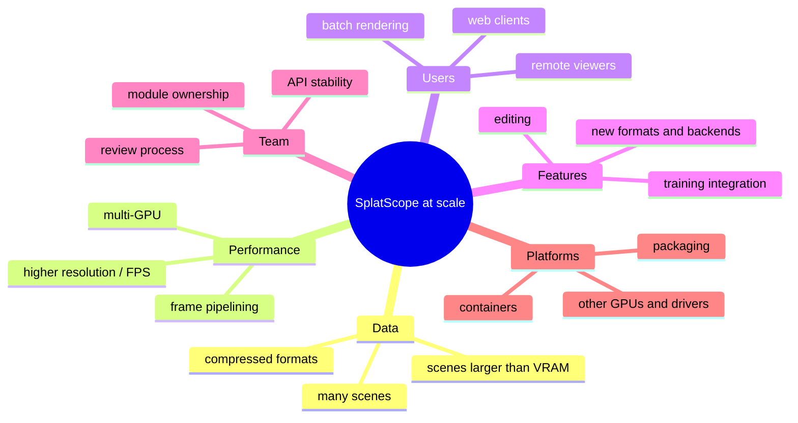
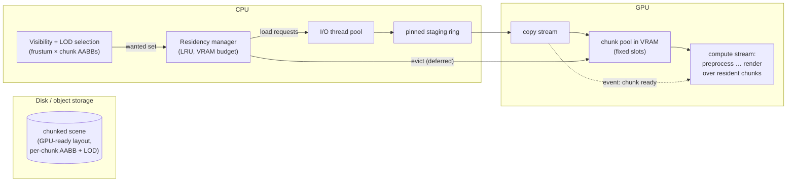
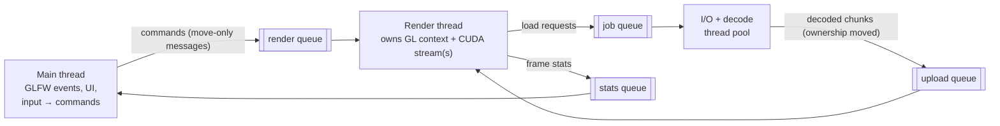

# 11 — Scaling Up & Production Engineering

> **Mental model:** *scaling means asking "what breaks first when X grows 10×?" for every X (data, frame rate, users, features, team, platforms), then putting a seam in front of that wall **before** you hit it. Production means the system keeps working, and keeps **telling you** how it's doing, when inputs are hostile, memory runs out and people other than you run it.*

This module is mostly **design studies**. Most of it you'll sketch and reason about rather than build, and that's how system-design interviews work too.

---

## 1. The scaling dimensions



For each dimension, the senior questions are the same: *what's the first wall, how far away is it, and what seam would make crossing it a local change?*

| Dimension | First wall | Seam that already exists | Seam to add |
|---|---|---|---|
| Data | 4 GB VRAM (≈6M Gaussians at SH3 fp32) | `HostScene` contract; fp16 storage switch | Chunked scene + residency manager (§2) |
| Performance | Single-frame-in-flight serialisation | Stage functions + lifetime-class buffers | Per-frame resource sets + deferred release (§3) |
| Users | One process, one window, one GPU | `IRenderer` is headless-capable (`ImageView`) | Render service + frame encoder (§5) |
| Features | Training needs gradients | Pipeline stages with explicit buffers | Python binding + backward kernels (§6) |
| Team | One person knows everything | Layers as CMake targets; ADRs; diagrams | CODEOWNERS, API versioning (§10) |
| Platforms | `CMAKE_CUDA_ARCHITECTURES native` binaries run only on your GPU | — | Fat binaries + PTX (§9) |

---

## 2. Data scaling: scenes larger than VRAM

### 2.1 The techniques

| Technique | Idea | Cost |
|---|---|---|
| **Spatial chunking** | Partition Gaussians into chunks (octree or grid cells), each with an AABB | Preprocessing step; chunk boundaries |
| **Hierarchical culling** | Test chunk AABBs against the frustum first; skip whole chunks | A tiny CPU or GPU pass per frame |
| **Level of detail (LOD)** | Far-away regions use merged, coarser Gaussians. Published work on hierarchical 3DGS builds exactly such trees for very large scenes | Building the hierarchy; popping at LOD transitions |
| **Streaming / out-of-core** | Only resident chunks live in VRAM; others load on demand from disk or host RAM | Async I/O, a residency manager, latency (blurry until loaded) |
| **Compression** | Quantisation, fp16, codebooks; decode on the GPU | Decode cost; quality loss |
| **Memory-mapped files** | `mmap` the scene file; the OS pages it in | Fast startup; needs a GPU-ready on-disk layout |

### 2.2 Architecture of a streaming renderer



### 2.3 The ownership problem streaming creates, and the standard answer

The residency manager **owns** the VRAM chunk slots. The renderer **borrows** the resident set every frame. Now the dangerous question: *what if a chunk is evicted while a kernel from the previous frame still reads it?*

```
 frame N:    render kernels reading chunk 7 ██████████████
 frame N+1:  residency decides to evict chunk 7 ──▶ slot reused for chunk 42 ──▶ upload overwrites it
                                                    ✗ frame N's kernels may still be reading it
```

**Deferred release (a "retirement queue")** is the standard production pattern (graphics engines use it for every GPU resource):

```
 evict(chunk 7) at frame N+1 ──▶ retire_queue.push({slot 7, release_after = frame N+1})
 each frame: if GPU has finished frame F (event / fence query) → free all retirements with release_after ≤ F
```

Ownership becomes: *the slot is owned by the residency manager, borrowed by in-flight frames, and only released when the last frame that could borrow it has **completed on the GPU***. That's module 03 §9's async-lifetime rule, generalised.

**Handles instead of pointers.** Kernels and the CPU refer to chunks by `{slot, generation}` handles (module 03 §12). A stale handle (the generation doesn't match) is detected instead of silently reading another chunk's data.

---

## 3. Performance scaling: frames in flight and overlap

### 3.1 From one frame in flight to N

```
 today (1 in flight):
 CPU  │ prep F0 │ wait │ prep F1 │ wait │ …
 GPU          │ F0 ███ │        │ F1 ███ │
 → each side idles while the other works

 pipelined (2 in flight):
 CPU  │ prep F0 │ prep F1 │ prep F2 │ …
 GPU          │ F0 ███  │ F1 ███  │ F2 ███ │
 → needs: per-frame resource SETS (2× the per-frame buffers), events per frame,
          deferred release, and accepting one extra frame of latency
```

**What changes architecturally:** every per-frame buffer becomes `std::array<FrameResources, kFramesInFlight>`, indexed by `frame % kFramesInFlight`. Before reusing set *i*, the host waits on that set's event. The L-readback sync complicates this, because the host needs L before it can launch the rest of the frame. Production systems handle it by sizing from the previous frame's L with an overflow check ([`gpu-forward-pass/03` alternatives](../gpu-forward-pass/03-memory-and-data-movement.md#alternatives--trade-offs)).

### 3.2 Other performance levers

| Lever | Gain | Cost |
|---|---|---|
| Multiple streams (upload ‖ compute) | Hides streaming uploads | Cross-stream events; more ownership bookkeeping |
| CUDA Graphs | Lower CPU launch overhead | Static shapes; L changes per frame (needs graph update or conditional nodes) |
| Dynamic resolution | Holds the frame-time target under load | Image quality varies |
| Quality knobs (SH degree, α threshold, max L) | Predictable trade-offs | UI and settings complexity |
| Multi-GPU (split screen into regions, or the scene into parts) | Scales throughput | Compositing across GPUs; a different architecture (rarely worth it for a viewer) |

---

## 4. Threading architecture for a production viewer



**Ownership rules that keep it safe:**

- Each thread **owns** its resources. The render thread owns all GL and CUDA objects (a GL context is current on one thread).
- Data crosses threads only by **moving ownership through a queue** (`std::unique_ptr<Chunk>`, move-only messages). There's no shared mutable state, so there are no locks beyond the queues themselves.
- Read-only shared data (`shared_ptr<const HostScene>`) needs no synchronisation.

| Alternative | Pros | Cons |
|---|---|---|
| Single thread (today) | Simplest; deterministic | Long loads freeze the UI |
| **Main + render + worker pool** (above) | Responsive UI; overlapped I/O | Message design, shutdown ordering |
| Job system / task graph (work-stealing) | Scales to many cores | Complex; overkill for a viewer |

**Shutdown order** is the classic production bug: stop accepting jobs → drain or cancel the queues → join the workers → destroy GPU resources on the render thread → destroy the context. Draw it as a sequence diagram before writing it.

---

## 5. Serving many users: four deployment architectures

```
 A. Desktop app (today)             B. Remote rendering service
 [user]─[SplatScope + local GPU]    [browser]◀─video (H.264/AV1 via NVENC, WebRTC)─[render server GPUs]
                                    [browser]──input events──────────────────────▶[ session per user ]

 C. Client-side web viewer          D. Batch render farm
 [browser WebGL/WebGPU renderer]    [API]─▶[job queue]─▶[GPU workers]─▶[object storage: images/videos]
     ▲ compressed scene from CDN
```

| | A. Desktop | B. Remote rendering | C. Client-side web | D. Batch farm |
|---|---|---|---|---|
| Latency | Lowest | Network RTT + encode/decode | Low (local) | N/A (offline) |
| Client requirements | NVIDIA GPU | Any browser | A decent GPU in the browser | None |
| Server cost | None | **One GPU slice per concurrent user** | CDN bandwidth only | GPU-hours per job |
| Scene privacy | Local | Never leaves the server | Downloaded to the client | Server-side |
| Scaling unit | Per user's machine | GPU sessions; packing users per GPU | CDN | Queue depth → autoscale workers |
| SplatScope reuse | All of it | `IRenderer` + headless `ImageView` + an encoder adapter | The algorithm only (rewrite in WGSL/GLSL; graphics-pipeline variant) | `IRenderer` + headless + `--bench`-style camera paths |

**Design study B in brief (an interview classic: "design a remote 3DGS viewer for 1000 users"):**

- **Session manager:** assigns users to GPU workers.
- **Worker process per GPU**, hosting several sessions. Each session has its own CUDA stream and per-frame resources; scene buffers are shared, read-only, between sessions viewing the same scene (`shared_ptr<const>` across sessions!).
- **NVENC encoder adapter** behind a `FrameSink` port.
- **Capacity:** measured frame cost per session (module 08) ÷ the frame budget = sessions per GPU, which then gives the GPU count and cost.
- **Failure handling:** a sticky CUDA error kills the worker process (it can't recover in-process). A supervisor restarts it, and sessions reconnect. **Process isolation is the unit of fault containment.**
- **Observability:** per-session frame time, encode time, network RTT, GPU utilisation and VRAM.

---

## 6. Integrating with training code (Python)

Most 3DGS work happens in Python/PyTorch. A production-quality renderer often ships as a Python extension.

```
 Python (PyTorch)                         C++/CUDA extension (pybind11 / nanobind)
 ┌──────────────────────────┐             ┌────────────────────────────────────────┐
 │ means = torch.tensor(...) │──DLPack /──▶│ DeviceSpan<const Vec4f> (BORROWED view)│
 │   (owned by PyTorch's     │ __cuda_     │ render(...) on the CALLER's stream      │
 │    caching allocator)     │ array_      │ outputs: tensors allocated by PyTorch   │
 └──────────────────────────┘ interface__ └────────────────────────────────────────┘
```

**The ownership lessons across a language boundary:**

- **Zero-copy means borrowing.** Your C++ code receives *views* of memory that PyTorch owns. You must not free it, and must not keep views after the call returns: Python may free or reuse that memory.
- **Outputs:** either allocate through the framework's allocator (it owns them), or hand ownership out through a capsule with a deleter (DLPack's protocol does this).
- **Streams:** run on the stream the caller gives you (PyTorch's current stream), or ordering with the caller's work breaks. The reference rasterizer's `std::function` resize-callback allocator exists for exactly this reason: the framework owns the memory, not the renderer.
- **Architecture:** this is a new **adapter** on the `IRenderer` port. The core doesn't change.

---

## 7. Observability: knowing what production is doing

| Pillar | What | SplatScope form | Service form |
|---|---|---|---|
| **Logs** | Discrete events with context | Startup device report, path selection, scene info, warnings | Structured JSON logs with session and request ids |
| **Metrics** | Numbers over time | `FrameStats` (N, L, stage ms, VRAM) | Histograms (p50/p95/p99 frame time), gauges (VRAM, sessions) → Prometheus-style |
| **Traces** | Where time goes in one operation | NVTX ranges → Nsight Systems | Distributed traces (OpenTelemetry): request → render → encode → send |
| **Crash data** | What happened at failure | Exception message + CUDA error context; core dumps (`ulimit -c`) | Crash reporting service; automatic worker restart with a reason |

**Senior habit: define SLOs** (service-level objectives) in the same form as the quality-attribute scenarios from module 01. For example: "p95 frame time ≤ 33 ms for 99% of sessions over 30 days". That turns "is it fast enough?" into a monitored number with an error budget.

---

## 8. Robustness and security: hostile input and failure

| Threat / failure | Example | Defence |
|---|---|---|
| **Allocation bomb** | PLY header claims `element vertex 4000000000` | Validate counts against the file size and a configured maximum *before* allocating |
| **Integer overflow** | `N * 48 * sizeof(float)` wraps around | Checked multiplication helpers for every size computation |
| Truncated or corrupt file | File ends mid-row | Parser checks bounds; fuzzing (module 10) |
| Wrong property types | `double` where `float` is expected, or `uchar` colours | Explicit type handling or rejection with a message |
| Non-finite values | NaN scales | Validation at the boundary (already in the loader) |
| VRAM exhaustion | Close-up view explodes L | L cap + `Degraded` state; never OOM mid-frame |
| Sticky CUDA error | Kernel bug in production | Report and exit cleanly (desktop); supervised restart (service) |
| GPU watchdog | Very long kernels on a GPU that drives a display may be killed by the driver | Keep each kernel's runtime short; the tile design already does |
| Dependency vulnerabilities | An old parser library | Pin versions; update deliberately; fuzz the integration |

**Principle: validate at the boundary, trust inside.** The `HostScene` contract makes this concrete: everything past the loader may assume the invariants hold, because the loader is the one place that checks them.

---

## 9. Packaging and distribution

| Concern | Production answer |
|---|---|
| **GPU architectures** | `native` builds only run on your GPU. Ship **fat binaries**: SASS for each supported architecture *plus PTX* for the newest, so future GPUs can JIT-compile (`-gencode arch=compute_75,code=[sm_75,compute_75]`, and more architectures as needed) |
| **CUDA runtime** | Link `cudart` statically (CMake's `CUDA::cudart_static`) to remove a runtime dependency. The driver must still be new enough: document the minimum version |
| **Library consumers** | CMake `install(TARGETS … EXPORT …)` + a package config file, so `find_package(SplatScope)` works. Version it with semantic versioning |
| **ABI stability** | C++ ABI breaks easily. Stable public headers with PIMPL, no STL types across a shared-library boundary unless you control the compiler, or a C API for plugins |
| **Dependencies** | vcpkg or Conan manifests for reproducible builds, as an alternative to FetchContent |
| **Linux desktop distribution** | AppImage or Flatpak (the GPU driver comes from the host) |
| **Services** | Containers based on `nvidia/cuda` runtime images + the NVIDIA Container Toolkit; the image is pinned per release |

---

## 10. Scaling the team

| Practice | Why |
|---|---|
| **Layers as separately owned modules** (CODEOWNERS per directory) | Clear review responsibility; parallel work |
| **Stable interfaces with a deprecation policy** | Teams can change implementations without coordinating every change |
| **Design docs / RFCs for cross-cutting changes**, ADRs for decisions | Asynchronous, recorded decision-making (module 01 §7) |
| **Architecture fitness functions** | Automated checks that the architecture holds: "`render/cuda` must not depend on `present/`", enforced by CMake target boundaries or a dependency-check script in CI |
| **Onboarding path** | README → diagrams → ADRs → this course. A newcomer's first PR within a day is the measure |
| **Blameless post-mortems** | When something breaks: timeline, contributing factors, action items. Focus on systems, not people |

---

## 11. Design studies (do these on paper)

For each: write a one-page design doc (module 01 §7.1) with at least two options, diagrams, ownership and a capacity estimate.

1. **DS-1, out-of-core:** a 50M-Gaussian scene on the 4 GB laptop. Chunking scheme, residency policy, LOD, ownership of slots, deferred release, what the user sees while chunks load.
2. **DS-2, remote viewer for 1000 concurrent users** (§5 B): sessions per GPU from your measured frame cost, GPU count, failure handling, cost per user-hour, scene sharing between sessions.
3. **DS-3, PyTorch extension** (§6): API surface, memory ownership across the boundary, stream handling, how the CPU oracle becomes a test in Python.
4. **DS-4, multi-format loader ecosystem** (module 04 §7): when does a plugin architecture beat additional `load_*` functions? Design the C ABI if you choose plugins.
5. **DS-5, two frames in flight** (§3.1): which buffers double, where the events go, how the L readback is handled, what the latency cost is.

---

## 12. Interview probes (system-design flavour)

| Question | Strong answer shape |
|---|---|
| "How would you render a scene that doesn't fit in GPU memory?" | Chunking + culling + LOD + streaming residency with a budget; deferred release for chunks still in use; handles with generations |
| "Design a cloud service that renders 3DGS for many users." | Options A–D with trade-offs; sessions per GPU from measured cost; process-per-GPU isolation; encoder; observability; failure recovery |
| "How do you free GPU memory that might still be in use?" | Deferred release keyed to a fence/event for the last frame that could use it |
| "How do you share data between threads safely?" | Immutable sharing, or ownership transfer through queues; locks only around the queues |
| "What can go wrong when your library is called from Python?" | Ownership of borrowed memory, stream ordering, the GIL, exception translation, ABI and packaging |
| "Your binary works on your machine but crashes on a customer's GPU." | Built for `native` only: ship SASS for target architectures + PTX; check driver/runtime compatibility |
| "How do you make a parser safe for untrusted input?" | Validate against file size and limits before allocating, checked arithmetic, bounds checks, fuzzing, sanitizers |
