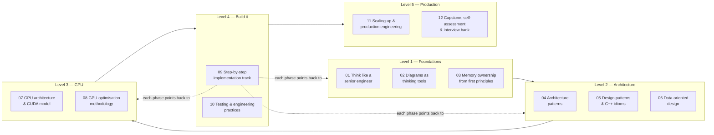

# SplatScope: Zero to Hero

**A self-contained course in software architecture, memory ownership, GPU optimisation and production engineering, learned by building a Gaussian Splatting viewer.**

This folder is separate from [`docs/gpu-forward-pass/`](../gpu-forward-pass/README.md). That folder is the *specification* of the GPU renderer: the review of the branch, the kernel maths and the buffer inventory. This folder is the *course*. It teaches the ideas behind those decisions, in an order that lets you build them one at a time, and it shows you the other designs you could have picked.

---

## Who this is for, and what you'll be able to do

You already write C++17/20, CMake, GLSL and some CUDA. By the end you should be able to:

1. **Think like a senior engineer**: frame a problem, list constraints, compare designs, write the decision down, and know which decisions are cheap to change and which aren't.
2. **Draw a system** at four zoom levels (context → containers → components → classes), plus ownership, sequence, state, data-flow and memory-layout diagrams. You'll know which picture answers which question.
3. **Recognise and apply the architecture patterns other engineers use and expect to see**: Layered, Ports & Adapters, Pipes & Filters, Data-Oriented Design, Event-driven, Plugin, Render Graph. You'll also know when each is overkill.
4. **Own memory deliberately**: say who owns every resource, how long it lives and who may borrow it, for host memory, GPU memory, OpenGL handles and C-library handles alike.
5. **Optimise a GPU program methodically**: hypothesis → measurement → change → measurement, using a roofline model and Nsight.
6. **Take a learning project toward production**: testing strategy, CI, observability, packaging, robustness against bad input, scaling to bigger data and more users, and organising code so a team can work on it.

---

## The journey



| # | Module | You learn | You build (SplatScope) |
|---|---|---|---|
| 01 | [Think like a senior engineer](01-thinking-like-a-senior-engineer.md) | Problem framing, requirements, trade-offs, one-way vs two-way doors, ADRs, design docs | The SplatScope design brief + your first ADRs |
| 02 | [Diagrams as thinking tools](02-diagrams-as-thinking-tools.md) | C4, UML class/sequence/state, data-flow, ownership and memory diagrams | The full SplatScope diagram set |
| 03 | [Memory ownership from first principles](03-memory-ownership.md) | Lifetime, RAII, unique/shared/borrowed, move semantics, views, ownership across C APIs and the GPU | Ownership map + RAII wrapper design |
| 04 | [Architecture patterns](04-architecture-patterns.md) | Layered, Hexagonal, Pipes & Filters, ECS/DOD, Event-driven, Plugin, Render graph: and how to combine them | SplatScope's composite architecture (with alternatives) |
| 05 | [Design patterns & C++ idioms](05-design-patterns-and-cpp-idioms.md) | Strategy, Factory, Facade, PIMPL, Observer, Command, State, Adapter, Policy, CRTP, Type erasure | Pattern map of the codebase |
| 06 | [Data-oriented design](06-data-oriented-design.md) | Caches, AoS/SoA/AoSoA, alignment, hot/cold split, false sharing | `HostScene` layout and the CPU oracle |
| 07 | [GPU architecture & the CUDA model](07-gpu-architecture-and-cuda-model.md) | SIMT, warps, SMs, the memory hierarchy, occupancy, coalescing, divergence, streams | Mental model of the GTX 1650 running your kernels |
| 08 | [GPU optimisation methodology](08-gpu-optimisation-methodology.md) | Roofline, Amdahl, Nsight workflow, an ordered optimisation ladder, experiment logs | The SplatScope optimisation programme |
| 09 | [Step-by-step implementation track](09-implementation-track.md) | Turning all of the above into phases with checkpoints | The whole viewer, phase by phase |
| 10 | [Testing & engineering practices](10-testing-and-engineering-practices.md) | Test pyramid, oracles, sanitizers, static analysis, CI, code review, git workflow | Test suite, CI, presets |
| 11 | [Scaling up & production engineering](11-scaling-and-production.md) | Big data (streaming, LOD), performance scaling, services, observability, packaging, robustness, team scaling | Design studies for "SplatScope at scale" |
| 12 | [Capstone & self-assessment](12-capstone-and-self-assessment.md) | Rubrics, interview question bank, glossary | Your final design review |

---

## How each module is built

Every module follows the same structure, so you always know where to look:

```
┌──────────────────────────────────────────────────────────────────────┐
│ 1. Mental model        — the one sentence you recall under pressure   │
│ 2. The problem         — what breaks without this idea (failure mode) │
│ 3. Concepts            — first principles, diagrams, maths if needed  │
│ 4. Alternatives        — the competing designs, compared in a table   │
│ 5. Apply to SplatScope — concrete, ordered steps with checkpoints     │
│ 6. Senior lens         — questions a senior engineer would ask        │
│ 7. Interview probes    — likely follow-ups and the gotchas behind them│
└──────────────────────────────────────────────────────────────────────┘
```

**How to use it:**

- **Read modules 01–08 in order** the first time. They're short on code and heavy on models and diagrams.
- **Build with module 09 open.** Each implementation phase lists which earlier modules it relies on, and a checkpoint you can verify mechanically.
- **Keep module 10 next to you** while building, and read 11–12 once the viewer works.
- **Draw before you code.** Each "Apply to SplatScope" section asks for a diagram first. Senior engineers think in pictures; the code is the last step.
- **Write down every non-trivial decision as an ADR** (module 01). By the end you'll have a decision log that reads like a real project's history, which is excellent interview material.

---

## Diagram conventions used throughout

All diagrams are either **Mermaid** (rendered by GitHub) or **ASCII** (renders everywhere). In ownership and architecture diagrams:

| Notation | Meaning |
|---|---|
| `A *-- B` (filled diamond) | **Composition:** A owns B; B dies with A |
| `A o-- B` (hollow diamond) | **Aggregation / shared ownership:** A holds B but doesn't solely control its lifetime |
| `A --> B` | **Association / borrow:** A uses B; B must outlive the use |
| `A ..> B` (dashed) | **Dependency:** A's code mentions B (include, parameter type) |
| `A <\|.. B` | **Realisation:** B implements interface A |
| `⟨owner⟩` `⟨view⟩` `⟨lease⟩` | Ownership role of a type (module 03) |
| Solid boxes / dashed boxes | Things that exist at runtime / compile-time-only concepts |

**Notation for memory diagrams** (modules 03, 06, 07):

```
 HOST (pageable)        HOST (pinned)          DEVICE (VRAM)              GL objects
 ┌───────────┐          ┌───────────┐          ┌───────────┐             ┌───────────┐
 │ std::vector│ ───────▶│ staging    │ ══DMA══▶│ DeviceBuf  │ ──interop──▶│ PBO / tex │
 └───────────┘          └───────────┘          └───────────┘             └───────────┘
   ───▶ CPU copy          ══▶ PCIe DMA           ──▶ device-local
```

---

## Relationship to the existing docs

| You want… | Read |
|---|---|
| *Why* an architecture is shaped the way it is, alternatives, how to think about it | **this folder** |
| *Exactly what* SplatScope's GPU pipeline does: kernel specs, buffer tables, review findings with line numbers | [`docs/gpu-forward-pass/`](../gpu-forward-pass/README.md) |

Where this course needs a SplatScope-specific detail (a kernel's maths, a buffer size), it links to the spec instead of repeating it, so there's one source of truth for each fact.
